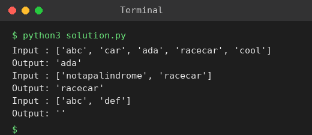

# Exp 1: First Palindromic String in an Array

## Aim
To find the first palindromic string in an array of words.

## Algorithm
1. Traverse the words from left to right
2. For each word compare characters from both ends moving inward (two pointers)
3. If all pairs match, return that word immediately
4. If no word is a palindrome, return an empty string

## Input
```
words = ["abc","car","ada","racecar","cool"]
words = ["notapalindrome","racecar"]
```

## Program
[`solution.py`](solution.py)

```python
def first_palindrome(words):
    for w in words:
        if all(w[i] == w[-1 - i] for i in range(len(w) // 2)):
            return w
    return ""

for words in (["abc", "car", "ada", "racecar", "cool"], ["notapalindrome", "racecar"], ["abc", "def"]):
    print("Input :", words)
    print("Output:", repr(first_palindrome(words)))
```

## Output
```
Input : ['abc', 'car', 'ada', 'racecar', 'cool']
Output: 'ada'
Input : ['notapalindrome', 'racecar']
Output: 'racecar'
Input : ['abc', 'def']
Output: ''
```

## Screenshot


## Result
The program for **First Palindromic String in an Array** was implemented and executed successfully, and the output shown above was obtained for all the given test cases.

## Time and Space Complexity
| | Complexity |
|---|---|
| **Time** | O(L), L = total characters in all words |
| **Space** | O(1) |
