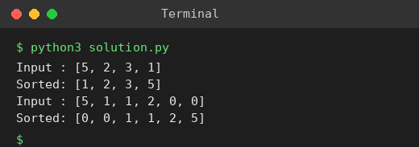

# Exp 10: Sort an Array in O(n log n) with Minimum Space (Heap Sort)

## Aim
To sort an integer array in ascending order without built-in functions in O(n log n) time and the smallest possible space.

## Algorithm
1. Build a max-heap from the array in place
2. Swap the root (maximum) with the last element of the heap and shrink the heap by one
3. Sift the new root down to restore the heap
4. Repeat until the heap has one element

## Input
```
[5,2,3,1]
[5,1,1,2,0,0]
```

## Program
[`solution.py`](solution.py)

```python
def heapify(a, n, i):
    while True:
        largest, l, r = i, 2 * i + 1, 2 * i + 2
        if l < n and a[l] > a[largest]: largest = l
        if r < n and a[r] > a[largest]: largest = r
        if largest == i:
            return
        a[i], a[largest] = a[largest], a[i]
        i = largest

def heap_sort(a):
    n = len(a)
    for i in range(n // 2 - 1, -1, -1):
        heapify(a, n, i)
    for end in range(n - 1, 0, -1):
        a[0], a[end] = a[end], a[0]
        heapify(a, end, 0)
    return a

for a in ([5, 2, 3, 1], [5, 1, 1, 2, 0, 0]):
    print("Input :", a)
    print("Sorted:", heap_sort(a[:]))
```

## Output
```
Input : [5, 2, 3, 1]
Sorted: [1, 2, 3, 5]
Input : [5, 1, 1, 2, 0, 0]
Sorted: [0, 0, 1, 1, 2, 5]
```

## Screenshot


## Result
The program for **Sort an Array in O(n log n) with Minimum Space (Heap Sort)** was implemented and executed successfully, and the output shown above was obtained for all the given test cases.

## Time and Space Complexity
| | Complexity |
|---|---|
| **Time** | O(n log n) in best, average and worst case |
| **Space** | O(1) auxiliary (in-place) |
