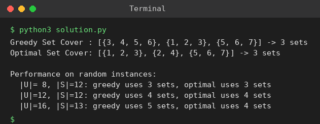

# Exp 100: Greedy Set Cover

## Aim
To implement the greedy approximation algorithm for Set Cover, compare it with the optimal cover, and analyse it on different input sizes.

## Algorithm
1. Greedy: while elements remain uncovered pick the set that covers the largest number of uncovered elements
2. Add it to the cover and remove its elements from the uncovered set
3. Optimal: check all combinations of sets in increasing size
4. Compare the number of sets; repeat for random instances of growing size

## Input
```
U = {1,2,3,4,5,6,7}
S = {{1,2,3},{2,4},{3,4,5,6},{4,5},{5,6,7},{6,7}}
```

## Program
[`solution.py`](solution.py)

```python
import random
from itertools import combinations

def greedy(U, S):
    U = set(U)
    chosen = []
    while U:
        best = max(S, key=lambda s: len(U & s))
        chosen.append(best)
        U -= best
    return chosen

def optimal(U, S):
    for k in range(1, len(S) + 1):
        for c in combinations(S, k):
            if set().union(*c) >= set(U):
                return list(c)

U = {1, 2, 3, 4, 5, 6, 7}
S = [{1, 2, 3}, {2, 4}, {3, 4, 5, 6}, {4, 5}, {5, 6, 7}, {6, 7}]
g, o = greedy(U, S), optimal(U, S)
print("Greedy Set Cover :", g, "->", len(g), "sets")
print("Optimal Set Cover:", o, "->", len(o), "sets")

print("\nPerformance on random instances:")
random.seed(1)
for size in (8, 12, 16):
    univ = set(range(size))
    sets = [set(random.sample(sorted(univ), random.randint(2, size // 2))) for _ in range(12)]
    sets.append(univ - set().union(*sets))
    sets = [s for s in sets if s]
    print(f"  |U|={size:>2}, |S|={len(sets):>2}: greedy uses {len(greedy(univ, sets))} sets, optimal uses {len(optimal(univ, sets))} sets")
```

## Output
```
Greedy Set Cover : [{3, 4, 5, 6}, {1, 2, 3}, {5, 6, 7}] -> 3 sets
Optimal Set Cover: [{1, 2, 3}, {2, 4}, {5, 6, 7}] -> 3 sets

Performance on random instances:
  |U|= 8, |S|=12: greedy uses 3 sets, optimal uses 3 sets
  |U|=12, |S|=12: greedy uses 4 sets, optimal uses 4 sets
  |U|=16, |S|=13: greedy uses 5 sets, optimal uses 4 sets
```

## Screenshot


## Result
The program for **Greedy Set Cover** was implemented and executed successfully, and the output shown above was obtained for all the given test cases.

> **Note:** For this instance no two sets cover the universe (the union of any two leaves an element out), so the optimum is 3 sets and greedy matches it; the sheet's claim of an optimal cover of size 2 is not possible.

## Time and Space Complexity
| | Complexity |
|---|---|
| **Time** | Greedy O(|U| * |S|); optimal brute force O(2^|S|); greedy is a ln(n)-approximation |
| **Space** | O(|U| + |S|) |
