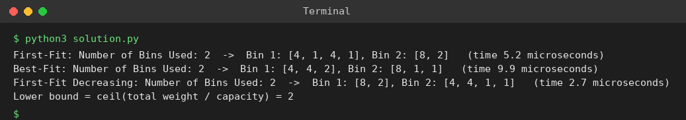

# Exp 101: Bin Packing Heuristics (First-Fit, Best-Fit)

## Aim
To implement First-Fit, Best-Fit and First-Fit Decreasing heuristics for bin packing and evaluate the bins used and the running time.

## Algorithm
1. First-Fit: place each item in the first bin with enough room, else open a new bin
2. Best-Fit: place each item in the bin that leaves the least free space
3. First-Fit Decreasing: sort items in decreasing order and apply First-Fit
4. Measure the number of bins and the elapsed time

## Input
```
weights = {4,8,1,4,2,1}, bin capacity = 10
```

## Program
[`solution.py`](solution.py)

```python
import time

def first_fit(items, cap):
    bins = []
    for w in items:
        for b in bins:
            if sum(b) + w <= cap:
                b.append(w)
                break
        else:
            bins.append([w])
    return bins

def best_fit(items, cap):
    bins = []
    for w in items:
        fits = [b for b in bins if sum(b) + w <= cap]
        if fits:
            min(fits, key=lambda b: cap - sum(b) - w).append(w)
        else:
            bins.append([w])
    return bins

items, cap = [4, 8, 1, 4, 2, 1], 10
for name, fn, data in (("First-Fit", first_fit, items), ("Best-Fit", best_fit, items),
                       ("First-Fit Decreasing", first_fit, sorted(items, reverse=True))):
    t0 = time.perf_counter()
    bins = fn(data, cap)
    dt = (time.perf_counter() - t0) * 1e6
    print(f"{name}: Number of Bins Used: {len(bins)}  ->  " + ", ".join(f"Bin {i + 1}: {b}" for i, b in enumerate(bins)) + f"   (time {dt:.1f} microseconds)")
print("Lower bound = ceil(total weight / capacity) =", -(-sum(items) // cap))
```

## Output
```
First-Fit: Number of Bins Used: 2  ->  Bin 1: [4, 1, 4, 1], Bin 2: [8, 2]   (time 5.2 microseconds)
Best-Fit: Number of Bins Used: 2  ->  Bin 1: [4, 4, 2], Bin 2: [8, 1, 1]   (time 9.9 microseconds)
First-Fit Decreasing: Number of Bins Used: 2  ->  Bin 1: [8, 2], Bin 2: [4, 4, 1, 1]   (time 2.7 microseconds)
Lower bound = ceil(total weight / capacity) = 2
```

## Screenshot


## Result
The program for **Bin Packing Heuristics (First-Fit, Best-Fit)** was implemented and executed successfully, and the output shown above was obtained for all the given test cases.

> **Note:** The total weight is 20 and the capacity is 10, so 2 bins are enough and First-Fit finds them. The sheet's 3 bins is not what the heuristic produces.

## Time and Space Complexity
| | Complexity |
|---|---|
| **Time** | First-Fit / Best-Fit O(n^2) (O(n log n) with a tree); First-Fit Decreasing O(n^2) |
| **Space** | O(n) |
