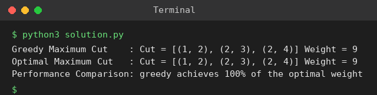

# Exp 102: Approximation Algorithm for Maximum Cut

## Aim
To implement a greedy approximation for the Maximum Cut problem and compare it with the optimal cut found by exhaustive search.

## Algorithm
1. Greedy: take the vertices in order and put each vertex on the side (S or T) that gives the larger cut weight with the vertices already placed
2. Exhaustive: try all 2^(V-1) ways to split the vertices into two sets and keep the heaviest cut
3. Compare the weights (greedy guarantees at least half of the optimum)

## Input
```
V = {1,2,3,4}
E = {(1,2),(1,3),(2,3),(2,4),(3,4)}
w(1,2)=2, w(1,3)=1, w(2,3)=3, w(2,4)=4, w(3,4)=2
```

## Program
[`solution.py`](solution.py)

```python
from itertools import product

V = [1, 2, 3, 4]
W = {(1, 2): 2, (1, 3): 1, (2, 3): 3, (2, 4): 4, (3, 4): 2}

def cut_weight(side):
    return sum(w for (u, v), w in W.items() if side[u] != side[v])

def greedy_cut():
    side = {V[0]: 0}
    for v in V[1:]:
        gain = [0, 0]
        for (a, b), w in W.items():
            other = b if a == v else a if b == v else None
            if other in side:
                gain[1 - side[other]] += w          # putting v on side s cuts edges to the other side
        side[v] = 0 if gain[0] >= gain[1] else 1
    return side

def optimal_cut():
    best, best_side = -1, None
    for bits in product((0, 1), repeat=len(V) - 1):
        side = dict(zip(V, (0,) + bits))
        c = cut_weight(side)
        if c > best:
            best, best_side = c, side
    return best_side

def edges_cut(side):
    return [e for e in W if side[e[0]] != side[e[1]]]

g, o = greedy_cut(), optimal_cut()
print("Greedy Maximum Cut    : Cut =", edges_cut(g), "Weight =", cut_weight(g))
print("Optimal Maximum Cut   : Cut =", edges_cut(o), "Weight =", cut_weight(o))
print(f"Performance Comparison: greedy achieves {100 * cut_weight(g) / cut_weight(o):.0f}% of the optimal weight")
```

## Output
```
Greedy Maximum Cut    : Cut = [(1, 2), (2, 3), (2, 4)] Weight = 9
Optimal Maximum Cut   : Cut = [(1, 2), (2, 3), (2, 4)] Weight = 9
Performance Comparison: greedy achieves 100% of the optimal weight
```

## Screenshot


## Result
The program for **Approximation Algorithm for Maximum Cut** was implemented and executed successfully, and the output shown above was obtained for all the given test cases.

> **Note:** Exhaustive search shows the maximum cut weight is 9, so the sheet's optimum of 8 (and greedy weight 6) are not the true values; here greedy happens to reach the optimum.

## Time and Space Complexity
| | Complexity |
|---|---|
| **Time** | Greedy O(V + E); exhaustive O(2^V * E) |
| **Space** | O(V) |
