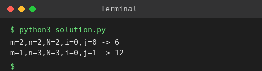

# Exp 11: Out of Boundary Paths

## Aim
To count the ways a ball can leave an m x n grid in exactly N steps from a starting cell.

## Algorithm
1. dp[r][c] = number of ways to be at (r,c) after the current step
2. For each of N steps, move every ball in the 4 directions
3. If the new cell is inside the grid add to the next dp, otherwise add to the 'out' counter
4. Return the 'out' counter after N steps

## Input
```
m=2, n=2, N=2, i=0, j=0
m=1, n=3, N=3, i=0, j=1
```

## Program
[`solution.py`](solution.py)

```python
def find_paths(m, n, N, i, j):
    dp = [[0] * n for _ in range(m)]
    dp[i][j] = 1
    out = 0
    for _ in range(N):
        nd = [[0] * n for _ in range(m)]
        for r in range(m):
            for c in range(n):
                v = dp[r][c]
                if v:
                    for dr, dc in ((1, 0), (-1, 0), (0, 1), (0, -1)):
                        nr, nc = r + dr, c + dc
                        if 0 <= nr < m and 0 <= nc < n:
                            nd[nr][nc] += v
                        else:
                            out += v
        dp = nd
    return out

print("m=2,n=2,N=2,i=0,j=0 ->", find_paths(2, 2, 2, 0, 0))
print("m=1,n=3,N=3,i=0,j=1 ->", find_paths(1, 3, 3, 0, 1))
```

## Output
```
m=2,n=2,N=2,i=0,j=0 -> 6
m=1,n=3,N=3,i=0,j=1 -> 12
```

## Screenshot


## Result
The program for **Out of Boundary Paths** was implemented and executed successfully, and the output shown above was obtained for all the given test cases.

## Time and Space Complexity
| | Complexity |
|---|---|
| **Time** | O(N * m * n) |
| **Space** | O(m * n) |
