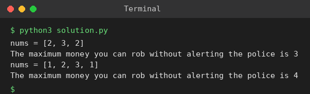

# Exp 12: House Robber II (Circular Street)

## Aim
To find the maximum money that can be robbed from houses arranged in a circle without robbing two adjacent houses.

## Algorithm
1. Because house 1 and house n are neighbours, they cannot both be robbed
2. Solve the linear problem twice: houses [0..n-2] and houses [1..n-1]
3. Linear DP: best = max(prev, prev2 + current)
4. Answer = max of the two results

## Input
```
nums = [2,3,2]
nums = [1,2,3,1]
```

## Program
[`solution.py`](solution.py)

```python
def rob_line(a):
    prev2 = prev = 0
    for x in a:
        prev2, prev = prev, max(prev, prev2 + x)
    return prev

def rob(nums):
    if len(nums) == 1:
        return nums[0]
    return max(rob_line(nums[:-1]), rob_line(nums[1:]))

for nums in ([2, 3, 2], [1, 2, 3, 1]):
    print(f"nums = {nums}")
    print("The maximum money you can rob without alerting the police is", rob(nums))
```

## Output
```
nums = [2, 3, 2]
The maximum money you can rob without alerting the police is 3
nums = [1, 2, 3, 1]
The maximum money you can rob without alerting the police is 4
```

## Screenshot


## Result
The program for **House Robber II (Circular Street)** was implemented and executed successfully, and the output shown above was obtained for all the given test cases.

## Time and Space Complexity
| | Complexity |
|---|---|
| **Time** | O(n) |
| **Space** | O(1) |
