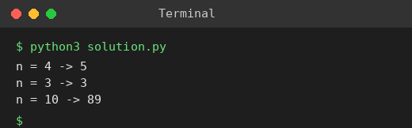

# Exp 13: Climbing Stairs

## Aim
To count the distinct ways to climb n stairs taking 1 or 2 steps at a time.

## Algorithm
1. ways(n) = ways(n-1) + ways(n-2) because the last move is a 1-step or a 2-step
2. ways(1) = 1, ways(2) = 2
3. Iterate from 3 to n keeping only the last two values
4. Return ways(n)

## Input
```
n = 4
n = 3
```

## Program
[`solution.py`](solution.py)

```python
def climb(n):
    if n <= 2:
        return n
    a, b = 1, 2
    for _ in range(3, n + 1):
        a, b = b, a + b
    return b

for n in (4, 3, 10):
    print(f"n = {n} -> {climb(n)}")
```

## Output
```
n = 4 -> 5
n = 3 -> 3
n = 10 -> 89
```

## Screenshot


## Result
The program for **Climbing Stairs** was implemented and executed successfully, and the output shown above was obtained for all the given test cases.

## Time and Space Complexity
| | Complexity |
|---|---|
| **Time** | O(n) |
| **Space** | O(1) |
