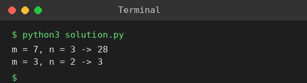

# Exp 14: Unique Paths in a Grid

## Aim
To count the unique paths a robot can take from the top-left to the bottom-right corner moving only right or down.

## Algorithm
1. dp[j] = number of paths to column j of the current row
2. First row and first column have exactly 1 path
3. dp[j] = dp[j] (from above) + dp[j-1] (from left)
4. Answer is dp[n-1] after the last row

## Input
```
m = 7, n = 3
m = 3, n = 2
```

## Program
[`solution.py`](solution.py)

```python
def unique_paths(m, n):
    dp = [1] * n
    for _ in range(1, m):
        for j in range(1, n):
            dp[j] += dp[j - 1]
    return dp[-1]

for m, n in ((7, 3), (3, 2)):
    print(f"m = {m}, n = {n} -> {unique_paths(m, n)}")
```

## Output
```
m = 7, n = 3 -> 28
m = 3, n = 2 -> 3
```

## Screenshot


## Result
The program for **Unique Paths in a Grid** was implemented and executed successfully, and the output shown above was obtained for all the given test cases.

## Time and Space Complexity
| | Complexity |
|---|---|
| **Time** | O(m * n) |
| **Space** | O(n) |
