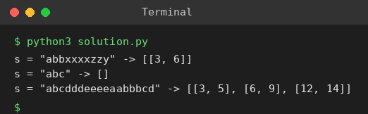

# Exp 15: Positions of Large Groups

## Aim
To return the intervals of every group of 3 or more consecutive identical characters in a string.

## Algorithm
1. Start at index i and extend j while s[j+1] == s[i]
2. The group is [i, j]
3. If its length j-i+1 >= 3 store the interval
4. Continue from j+1

## Input
```
s = "abbxxxxzzy"
s = "abc"
```

## Program
[`solution.py`](solution.py)

```python
def large_group_positions(s):
    res, i = [], 0
    while i < len(s):
        j = i
        while j + 1 < len(s) and s[j + 1] == s[i]:
            j += 1
        if j - i + 1 >= 3:
            res.append([i, j])
        i = j + 1
    return res

for s in ("abbxxxxzzy", "abc", "abcdddeeeeaabbbcd"):
    print(f's = "{s}" ->', large_group_positions(s))
```

## Output
```
s = "abbxxxxzzy" -> [[3, 6]]
s = "abc" -> []
s = "abcdddeeeeaabbbcd" -> [[3, 5], [6, 9], [12, 14]]
```

## Screenshot


## Result
The program for **Positions of Large Groups** was implemented and executed successfully, and the output shown above was obtained for all the given test cases.

## Time and Space Complexity
| | Complexity |
|---|---|
| **Time** | O(n) |
| **Space** | O(1) extra (excluding the output) |
