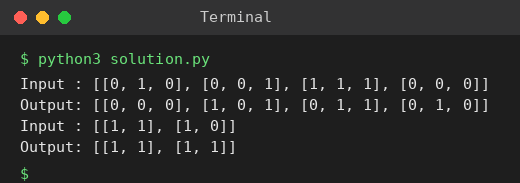

# Exp 16: Conway's Game of Life

## Aim
To compute the next state of an m x n board of live (1) and dead (0) cells using Conway's rules.

## Algorithm
1. Encode states in place: bit0 = current state, bit1 = next state
2. For each cell count live neighbours using bit0 of the 8 neighbours
3. Apply the rules: live with 2 or 3 neighbours stays alive; dead with exactly 3 becomes alive
4. Shift every cell right by one bit to expose the next state

## Input
```
[[0,1,0],[0,0,1],[1,1,1],[0,0,0]]
[[1,1],[1,0]]
```

## Program
[`solution.py`](solution.py)

```python
def game_of_life(b):
    m, n = len(b), len(b[0])
    for i in range(m):
        for j in range(n):
            live = sum(b[x][y] & 1
                       for x in range(max(0, i - 1), min(m, i + 2))
                       for y in range(max(0, j - 1), min(n, j + 2)) if (x, y) != (i, j))
            if b[i][j] == 1 and live in (2, 3):
                b[i][j] = 3
            elif b[i][j] == 0 and live == 3:
                b[i][j] = 2
    for i in range(m):
        for j in range(n):
            b[i][j] >>= 1
    return b

for board in ([[0, 1, 0], [0, 0, 1], [1, 1, 1], [0, 0, 0]], [[1, 1], [1, 0]]):
    print("Input :", board)
    print("Output:", game_of_life([row[:] for row in board]))
```

## Output
```
Input : [[0, 1, 0], [0, 0, 1], [1, 1, 1], [0, 0, 0]]
Output: [[0, 0, 0], [1, 0, 1], [0, 1, 1], [0, 1, 0]]
Input : [[1, 1], [1, 0]]
Output: [[1, 1], [1, 1]]
```

## Screenshot


## Result
The program for **Conway's Game of Life** was implemented and executed successfully, and the output shown above was obtained for all the given test cases.

## Time and Space Complexity
| | Complexity |
|---|---|
| **Time** | O(m * n) |
| **Space** | O(1) (in-place) |
