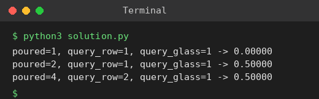

# Exp 17: Champagne Tower

## Aim
To find how full the j-th glass of the i-th row is after pouring a given amount of champagne into a pyramid of glasses.

## Algorithm
1. Keep the amount that reaches each glass of the current row (start with all poured liquid in the top glass)
2. For each row, any amount above 1 cup overflows; half goes to each of the two glasses below
3. Repeat until the query row is reached
4. Answer = min(1, amount in query glass)

## Input
```
poured = 1, query_row = 1, query_glass = 1
poured = 2, query_row = 1, query_glass = 1
```

## Program
[`solution.py`](solution.py)

```python
def champagne_tower(poured, query_row, query_glass):
    row = [float(poured)]
    for _ in range(query_row):
        nxt = [0.0] * (len(row) + 1)
        for k, v in enumerate(row):
            if v > 1:
                extra = (v - 1) / 2
                nxt[k] += extra
                nxt[k + 1] += extra
        row = nxt
    return min(1.0, row[query_glass])

for p, r, g in ((1, 1, 1), (2, 1, 1), (4, 2, 1)):
    print(f"poured={p}, query_row={r}, query_glass={g} -> {champagne_tower(p, r, g):.5f}")
```

## Output
```
poured=1, query_row=1, query_glass=1 -> 0.00000
poured=2, query_row=1, query_glass=1 -> 0.50000
poured=4, query_row=2, query_glass=1 -> 0.50000
```

## Screenshot


## Result
The program for **Champagne Tower** was implemented and executed successfully, and the output shown above was obtained for all the given test cases.

## Time and Space Complexity
| | Complexity |
|---|---|
| **Time** | O(r^2) for query row r |
| **Space** | O(r) |
