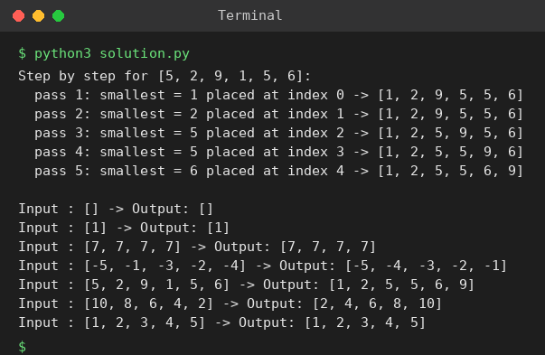

# Exp 18: Selection Sort

## Aim
To explain and implement Selection Sort, showing how it grows a sorted region on the left, and to test it on different inputs.

## Algorithm
1. Split the array into a sorted region (initially empty) and an unsorted region
2. Find the smallest element of the unsorted region
3. Swap it with the leftmost unsorted element and move the boundary one step right
4. Repeat until the unsorted region has one element

## Input
```
[]  [1]  [7,7,7,7]  [-5,-1,-3,-2,-4]
[5,2,9,1,5,6]  [10,8,6,4,2]  [1,2,3,4,5]
```

## Program
[`solution.py`](solution.py)

```python
def selection_sort(a, trace=False):
    a = a[:]
    n = len(a)
    for i in range(n - 1):
        m = i
        for j in range(i + 1, n):
            if a[j] < a[m]:
                m = j
        a[i], a[m] = a[m], a[i]
        if trace:
            print(f"  pass {i + 1}: smallest = {a[i]} placed at index {i} -> {a}")
    return a

print("Step by step for [5, 2, 9, 1, 5, 6]:")
selection_sort([5, 2, 9, 1, 5, 6], trace=True)
print()
for a in ([], [1], [7, 7, 7, 7], [-5, -1, -3, -2, -4], [5, 2, 9, 1, 5, 6], [10, 8, 6, 4, 2], [1, 2, 3, 4, 5]):
    print("Input :", a, "-> Output:", selection_sort(a))
```

## Output
```
Step by step for [5, 2, 9, 1, 5, 6]:
  pass 1: smallest = 1 placed at index 0 -> [1, 2, 9, 5, 5, 6]
  pass 2: smallest = 2 placed at index 1 -> [1, 2, 9, 5, 5, 6]
  pass 3: smallest = 5 placed at index 2 -> [1, 2, 5, 9, 5, 6]
  pass 4: smallest = 5 placed at index 3 -> [1, 2, 5, 5, 9, 6]
  pass 5: smallest = 6 placed at index 4 -> [1, 2, 5, 5, 6, 9]

Input : [] -> Output: []
Input : [1] -> Output: [1]
Input : [7, 7, 7, 7] -> Output: [7, 7, 7, 7]
Input : [-5, -1, -3, -2, -4] -> Output: [-5, -4, -3, -2, -1]
Input : [5, 2, 9, 1, 5, 6] -> Output: [1, 2, 5, 5, 6, 9]
Input : [10, 8, 6, 4, 2] -> Output: [2, 4, 6, 8, 10]
Input : [1, 2, 3, 4, 5] -> Output: [1, 2, 3, 4, 5]
```

## Screenshot


## Result
The program for **Selection Sort** was implemented and executed successfully, and the output shown above was obtained for all the given test cases.

> **Note:** Selection sort is simple (one loop to find the minimum, one swap) but it always performs O(n^2) comparisons, so it is inefficient for large data sets.

## Time and Space Complexity
| | Complexity |
|---|---|
| **Time** | O(n^2) in best, average and worst case (always n(n-1)/2 comparisons) |
| **Space** | O(1) |
