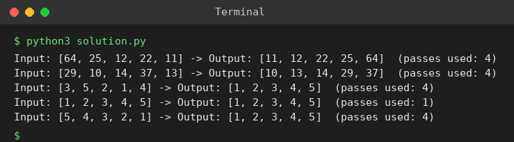

# Exp 19: Optimised Bubble Sort (Early Stop)

## Aim
To modify bubble sort so that it stops as soon as the list becomes sorted before all passes are completed.

## Algorithm
1. Use a flag 'swapped' for every pass
2. Compare and swap adjacent elements, set swapped = True on any swap
3. If a full pass makes no swap the list is already sorted, so break
4. Return the sorted list (and the number of passes used)

## Input
```
[64,25,12,22,11]  [29,10,14,37,13]  [3,5,2,1,4]
[1,2,3,4,5] (sorted)  [5,4,3,2,1] (reverse)
```

## Program
[`solution.py`](solution.py)

```python
def bubble_sort(a):
    a = a[:]
    n, passes = len(a), 0
    for i in range(n - 1):
        swapped = False
        passes += 1
        for j in range(n - 1 - i):
            if a[j] > a[j + 1]:
                a[j], a[j + 1] = a[j + 1], a[j]
                swapped = True
        if not swapped:
            break
    return a, passes

for a in ([64, 25, 12, 22, 11], [29, 10, 14, 37, 13], [3, 5, 2, 1, 4], [1, 2, 3, 4, 5], [5, 4, 3, 2, 1]):
    res, p = bubble_sort(a)
    print(f"Input: {a} -> Output: {res}  (passes used: {p})")
```

## Output
```
Input: [64, 25, 12, 22, 11] -> Output: [11, 12, 22, 25, 64]  (passes used: 4)
Input: [29, 10, 14, 37, 13] -> Output: [10, 13, 14, 29, 37]  (passes used: 4)
Input: [3, 5, 2, 1, 4] -> Output: [1, 2, 3, 4, 5]  (passes used: 4)
Input: [1, 2, 3, 4, 5] -> Output: [1, 2, 3, 4, 5]  (passes used: 1)
Input: [5, 4, 3, 2, 1] -> Output: [1, 2, 3, 4, 5]  (passes used: 4)
```

## Screenshot


## Result
The program for **Optimised Bubble Sort (Early Stop)** was implemented and executed successfully, and the output shown above was obtained for all the given test cases.

## Time and Space Complexity
| | Complexity |
|---|---|
| **Time** | Best O(n) (already sorted), average / worst O(n^2) |
| **Space** | O(1) |
