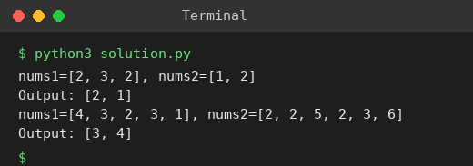

# Exp 2: Count Common Elements of Two Arrays

## Aim
To count how many elements of nums1 exist in nums2 and how many elements of nums2 exist in nums1.

## Algorithm
1. Build a hash set of each array
2. answer1 = number of elements of nums1 present in set(nums2)
3. answer2 = number of elements of nums2 present in set(nums1)
4. Return [answer1, answer2]

## Input
```
nums1 = [2,3,2], nums2 = [1,2]
nums1 = [4,3,2,3,1], nums2 = [2,2,5,2,3,6]
```

## Program
[`solution.py`](solution.py)

```python
def find_intersection_values(nums1, nums2):
    s1, s2 = set(nums1), set(nums2)
    return [sum(x in s2 for x in nums1), sum(x in s1 for x in nums2)]

for a, b in (([2, 3, 2], [1, 2]), ([4, 3, 2, 3, 1], [2, 2, 5, 2, 3, 6])):
    print(f"nums1={a}, nums2={b}")
    print("Output:", find_intersection_values(a, b))
```

## Output
```
nums1=[2, 3, 2], nums2=[1, 2]
Output: [2, 1]
nums1=[4, 3, 2, 3, 1], nums2=[2, 2, 5, 2, 3, 6]
Output: [3, 4]
```

## Screenshot


## Result
The program for **Count Common Elements of Two Arrays** was implemented and executed successfully, and the output shown above was obtained for all the given test cases.

## Time and Space Complexity
| | Complexity |
|---|---|
| **Time** | O(n + m) |
| **Space** | O(n + m) |
