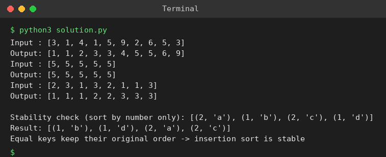

# Exp 20: Insertion Sort with Duplicate Elements

## Aim
To implement insertion sort that handles duplicate elements and to check that it preserves the relative order of equal elements (stability).

## Algorithm
1. Treat a[0..i-1] as sorted
2. Take key = a[i] and shift every element that is strictly greater than key one place right
3. Insert the key in the gap (equal elements are NOT moved past each other, so the sort is stable)
4. Repeat for all i

## Input
```
[3,1,4,1,5,9,2,6,5,3]
[5,5,5,5,5]
[2,3,1,3,2,1,1,3]
```

## Program
[`solution.py`](solution.py)

```python
def insertion_sort(a, key=lambda x: x):
    a = a[:]
    for i in range(1, len(a)):
        cur, j = a[i], i - 1
        while j >= 0 and key(a[j]) > key(cur):      # strictly greater -> stable
            a[j + 1] = a[j]
            j -= 1
        a[j + 1] = cur
    return a

for a in ([3, 1, 4, 1, 5, 9, 2, 6, 5, 3], [5, 5, 5, 5, 5], [2, 3, 1, 3, 2, 1, 1, 3]):
    print("Input :", a)
    print("Output:", insertion_sort(a))

pairs = [(2, 'a'), (1, 'b'), (2, 'c'), (1, 'd')]
print("\nStability check (sort by number only):", pairs)
print("Result:", insertion_sort(pairs, key=lambda p: p[0]))
print("Equal keys keep their original order -> insertion sort is stable")
```

## Output
```
Input : [3, 1, 4, 1, 5, 9, 2, 6, 5, 3]
Output: [1, 1, 2, 3, 3, 4, 5, 5, 6, 9]
Input : [5, 5, 5, 5, 5]
Output: [5, 5, 5, 5, 5]
Input : [2, 3, 1, 3, 2, 1, 1, 3]
Output: [1, 1, 1, 2, 2, 3, 3, 3]

Stability check (sort by number only): [(2, 'a'), (1, 'b'), (2, 'c'), (1, 'd')]
Result: [(1, 'b'), (1, 'd'), (2, 'a'), (2, 'c')]
Equal keys keep their original order -> insertion sort is stable
```

## Screenshot


## Result
The program for **Insertion Sort with Duplicate Elements** was implemented and executed successfully, and the output shown above was obtained for all the given test cases.

## Time and Space Complexity
| | Complexity |
|---|---|
| **Time** | Best O(n), average / worst O(n^2) |
| **Space** | O(1) |
