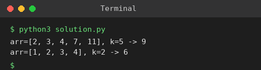

# Exp 21: Kth Missing Positive Number

## Aim
To find the k-th positive integer that is missing from a strictly increasing array.

## Algorithm
1. For index i, the count of missing numbers before arr[i] is arr[i] - (i + 1)
2. Binary search for the first index where this count is >= k
3. If low is that index, the answer is low + k
4. Return the answer

## Input
```
arr = [2,3,4,7,11], k = 5
arr = [1,2,3,4], k = 2
```

## Program
[`solution.py`](solution.py)

```python
def find_kth_positive(arr, k):
    lo, hi = 0, len(arr)
    while lo < hi:
        mid = (lo + hi) // 2
        if arr[mid] - (mid + 1) < k:
            lo = mid + 1
        else:
            hi = mid
    return lo + k

for arr, k in (([2, 3, 4, 7, 11], 5), ([1, 2, 3, 4], 2)):
    print(f"arr={arr}, k={k} -> {find_kth_positive(arr, k)}")
```

## Output
```
arr=[2, 3, 4, 7, 11], k=5 -> 9
arr=[1, 2, 3, 4], k=2 -> 6
```

## Screenshot


## Result
The program for **Kth Missing Positive Number** was implemented and executed successfully, and the output shown above was obtained for all the given test cases.

## Time and Space Complexity
| | Complexity |
|---|---|
| **Time** | O(log n) |
| **Space** | O(1) |
