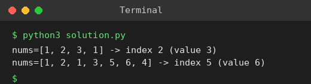

# Exp 22: Find Peak Element

## Aim
To find the index of a peak element (strictly greater than its neighbours) in O(log n) time.

## Algorithm
1. Set lo = 0, hi = n-1
2. While lo < hi compute mid
3. If nums[mid] < nums[mid+1] a peak lies on the right, so lo = mid + 1; otherwise hi = mid
4. When lo == hi it is a peak index

## Input
```
nums = [1,2,3,1]
nums = [1,2,1,3,5,6,4]
```

## Program
[`solution.py`](solution.py)

```python
def find_peak(nums):
    lo, hi = 0, len(nums) - 1
    while lo < hi:
        mid = (lo + hi) // 2
        if nums[mid] < nums[mid + 1]:
            lo = mid + 1
        else:
            hi = mid
    return lo

for nums in ([1, 2, 3, 1], [1, 2, 1, 3, 5, 6, 4]):
    i = find_peak(nums)
    print(f"nums={nums} -> index {i} (value {nums[i]})")
```

## Output
```
nums=[1, 2, 3, 1] -> index 2 (value 3)
nums=[1, 2, 1, 3, 5, 6, 4] -> index 5 (value 6)
```

## Screenshot


## Result
The program for **Find Peak Element** was implemented and executed successfully, and the output shown above was obtained for all the given test cases.

## Time and Space Complexity
| | Complexity |
|---|---|
| **Time** | O(log n) |
| **Space** | O(1) |
