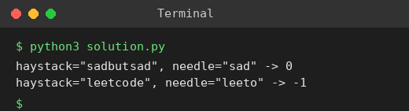

# Exp 23: Find the Index of the First Occurrence of a String (Brute Force)

## Aim
To return the index of the first occurrence of needle in haystack, or -1 if it does not occur.

## Algorithm
1. For every starting index i from 0 to len(haystack)-len(needle)
2. Compare the next len(needle) characters with needle
3. If they all match return i
4. If no start matches return -1

## Input
```
haystack = "sadbutsad", needle = "sad"
haystack = "leetcode", needle = "leeto"
```

## Program
[`solution.py`](solution.py)

```python
def str_str(haystack, needle):
    n, m = len(haystack), len(needle)
    for i in range(n - m + 1):
        j = 0
        while j < m and haystack[i + j] == needle[j]:
            j += 1
        if j == m:
            return i
    return -1

for h, nd in (("sadbutsad", "sad"), ("leetcode", "leeto")):
    print(f'haystack="{h}", needle="{nd}" -> {str_str(h, nd)}')
```

## Output
```
haystack="sadbutsad", needle="sad" -> 0
haystack="leetcode", needle="leeto" -> -1
```

## Screenshot


## Result
The program for **Find the Index of the First Occurrence of a String (Brute Force)** was implemented and executed successfully, and the output shown above was obtained for all the given test cases.

## Time and Space Complexity
| | Complexity |
|---|---|
| **Time** | O(n * m) |
| **Space** | O(1) |
