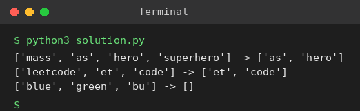

# Exp 24: Substrings of Other Words

## Aim
To return all strings of a word list that are substrings of another word in the list.

## Algorithm
1. For each word w, compare it with every other word v
2. If w occurs inside v, add w to the result and stop checking w
3. Return the result

## Input
```
words = ["mass","as","hero","superhero"]
words = ["leetcode","et","code"]
words = ["blue","green","bu"]
```

## Program
[`solution.py`](solution.py)

```python
def string_matching(words):
    res = []
    for i, w in enumerate(words):
        for j, v in enumerate(words):
            if i != j and w in v:
                res.append(w)
                break
    return res

for words in (["mass", "as", "hero", "superhero"], ["leetcode", "et", "code"], ["blue", "green", "bu"]):
    print(words, "->", string_matching(words))
```

## Output
```
['mass', 'as', 'hero', 'superhero'] -> ['as', 'hero']
['leetcode', 'et', 'code'] -> ['et', 'code']
['blue', 'green', 'bu'] -> []
```

## Screenshot


## Result
The program for **Substrings of Other Words** was implemented and executed successfully, and the output shown above was obtained for all the given test cases.

## Time and Space Complexity
| | Complexity |
|---|---|
| **Time** | O(n^2 * L) |
| **Space** | O(1) extra (excluding the output) |
