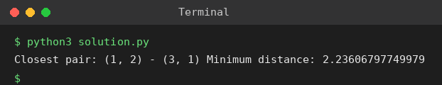

# Exp 25: Closest Pair of Points (Brute Force)

## Aim
To find the two closest points in a set of 2D points using the brute force approach.

## Algorithm
1. Define the Euclidean distance between two points
2. Compare every pair (i, j) with i < j
3. Keep the pair with the smallest distance
4. Print the closest pair and the minimum distance

## Input
```
Points: [(1, 2), (4, 5), (7, 8), (3, 1)]
```

## Program
[`solution.py`](solution.py)

```python
import math

def dist(p, q):
    return math.hypot(p[0] - q[0], p[1] - q[1])

def closest_pair(pts):
    best = (float("inf"), None, None)
    for i in range(len(pts)):
        for j in range(i + 1, len(pts)):
            d = dist(pts[i], pts[j])
            if d < best[0]:
                best = (d, pts[i], pts[j])
    return best

pts = [(1, 2), (4, 5), (7, 8), (3, 1)]
d, p, q = closest_pair(pts)
print(f"Closest pair: {p} - {q} Minimum distance: {d}")
```

## Output
```
Closest pair: (1, 2) - (3, 1) Minimum distance: 2.23606797749979
```

## Screenshot


## Result
The program for **Closest Pair of Points (Brute Force)** was implemented and executed successfully, and the output shown above was obtained for all the given test cases.

> **Note:** The sample sheet shows 1.4142135623730951, but dist((1,2),(3,1)) = sqrt(2^2 + 1^2) = sqrt(5) = 2.23606797749979. The program prints the mathematically correct value.

## Time and Space Complexity
| | Complexity |
|---|---|
| **Time** | O(n^2) |
| **Space** | O(1) |
