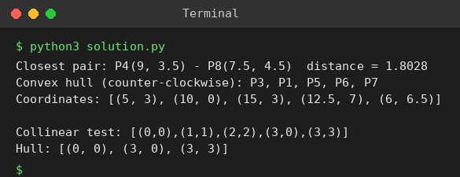

# Exp 26: Closest Pair and Convex Hull (Brute Force)

## Aim
To find the closest pair of points by brute force and to compute the convex hull of P1..P8 by brute force, handling collinear points.

## Algorithm
1. Closest pair: check all C(n,2) pairs with a Euclidean distance function
2. Convex hull: for every pair (a, b) check the sign of the cross product of all other points
3. If all other points lie on one side of line ab, then ab is a hull edge
4. Collinear points: a, b are accepted only if every collinear point lies between them, so only the extreme end points become vertices
5. Sort the hull vertices counter-clockwise

## Input
```
P1 (10,0), P2 (11,5), P3 (5,3), P4 (9,3.5), P5 (15,3), P6 (12.5,7), P7 (6,6.5), P8 (7.5,4.5)
```

## Program
[`solution.py`](solution.py)

```python
import math

def dist(p, q):
    return math.hypot(p[0] - q[0], p[1] - q[1])

def closest_pair(pts):
    best = (float("inf"), None, None)
    for i in range(len(pts)):
        for j in range(i + 1, len(pts)):
            d = dist(pts[i], pts[j])
            if d < best[0]:
                best = (d, pts[i], pts[j])
    return best

def cross(o, a, b):
    return (a[0] - o[0]) * (b[1] - o[1]) - (a[1] - o[1]) * (b[0] - o[0])

def between(p, a, b):
    return min(a[0], b[0]) <= p[0] <= max(a[0], b[0]) and min(a[1], b[1]) <= p[1] <= max(a[1], b[1])

def convex_hull_brute(pts):
    pts = list(dict.fromkeys(pts))
    n, hull = len(pts), set()
    for i in range(n):
        for j in range(i + 1, n):
            a, b = pts[i], pts[j]
            pos = neg = False
            ok = True
            for k in range(n):
                if k in (i, j):
                    continue
                c = cross(a, b, pts[k])
                if c > 0: pos = True
                elif c < 0: neg = True
                elif not between(pts[k], a, b):      # collinear but outside segment ab
                    ok = False
                    break
            if ok and not (pos and neg):
                hull.update((a, b))
    cx = sum(p[0] for p in hull) / len(hull)
    cy = sum(p[1] for p in hull) / len(hull)
    h = sorted(hull, key=lambda p: math.atan2(p[1] - cy, p[0] - cx))
    s = h.index(min(h))                                  # start from lowest-leftmost point
    return h[s:] + h[:s]

P = {"P1": (10, 0), "P2": (11, 5), "P3": (5, 3), "P4": (9, 3.5), "P5": (15, 3),
     "P6": (12.5, 7), "P7": (6, 6.5), "P8": (7.5, 4.5)}
name = {v: k for k, v in P.items()}
pts = list(P.values())
d, p, q = closest_pair(pts)
print(f"Closest pair: {name[p]}{p} - {name[q]}{q}  distance = {d:.4f}")
hull = convex_hull_brute(pts)
print("Convex hull (counter-clockwise):", ", ".join(name[h] for h in hull))
print("Coordinates:", hull)
print("\nCollinear test: [(0,0),(1,1),(2,2),(3,0),(3,3)]")
print("Hull:", convex_hull_brute([(0, 0), (1, 1), (2, 2), (3, 0), (3, 3)]))
```

## Output
```
Closest pair: P4(9, 3.5) - P8(7.5, 4.5)  distance = 1.8028
Convex hull (counter-clockwise): P3, P1, P5, P6, P7
Coordinates: [(5, 3), (10, 0), (15, 3), (12.5, 7), (6, 6.5)]

Collinear test: [(0,0),(1,1),(2,2),(3,0),(3,3)]
Hull: [(0, 0), (3, 0), (3, 3)]
```

## Screenshot


## Result
The program for **Closest Pair and Convex Hull (Brute Force)** was implemented and executed successfully, and the output shown above was obtained for all the given test cases.

> **Note:** The sheet lists P3, P4, P6, P5, P7, P1, but P4 (9, 3.5) lies inside the polygon, so it is not a hull vertex. The program computes the true hull: P3, P1, P5, P6, P7.

## Time and Space Complexity
| | Complexity |
|---|---|
| **Time** | Closest pair O(n^2); brute-force hull O(n^3) |
| **Space** | O(n) |
