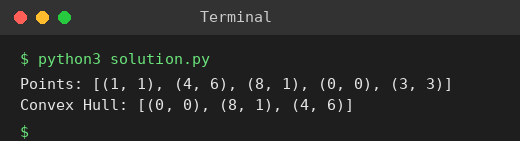

# Exp 27: Convex Hull (Brute Force)

## Aim
To find the convex hull of a set of 2D points using the brute force approach.

## Algorithm
1. For every pair of points (a, b) compute the cross product with each remaining point
2. If all points lie on the same side of line ab, the segment ab is an edge of the hull
3. Collect the end points of all such edges (collinear points are kept only if they are extremes)
4. Sort the vertices counter-clockwise

## Input
```
Points: [(1, 1), (4, 6), (8, 1), (0, 0), (3, 3)]
```

## Program
[`solution.py`](solution.py)

```python
import math

def cross(o, a, b):
    return (a[0] - o[0]) * (b[1] - o[1]) - (a[1] - o[1]) * (b[0] - o[0])

def between(p, a, b):
    return min(a[0], b[0]) <= p[0] <= max(a[0], b[0]) and min(a[1], b[1]) <= p[1] <= max(a[1], b[1])

def convex_hull_brute(pts):
    pts = list(dict.fromkeys(pts))
    n, hull = len(pts), set()
    for i in range(n):
        for j in range(i + 1, n):
            a, b = pts[i], pts[j]
            pos = neg = False
            ok = True
            for k in range(n):
                if k in (i, j):
                    continue
                c = cross(a, b, pts[k])
                if c > 0: pos = True
                elif c < 0: neg = True
                elif not between(pts[k], a, b):
                    ok = False
                    break
            if ok and not (pos and neg):
                hull.update((a, b))
    cx = sum(p[0] for p in hull) / len(hull)
    cy = sum(p[1] for p in hull) / len(hull)
    h = sorted(hull, key=lambda p: math.atan2(p[1] - cy, p[0] - cx))
    s = h.index(min(h))
    return h[s:] + h[:s]

pts = [(1, 1), (4, 6), (8, 1), (0, 0), (3, 3)]
print("Points:", pts)
print("Convex Hull:", convex_hull_brute(pts))
```

## Output
```
Points: [(1, 1), (4, 6), (8, 1), (0, 0), (3, 3)]
Convex Hull: [(0, 0), (8, 1), (4, 6)]
```

## Screenshot


## Result
The program for **Convex Hull (Brute Force)** was implemented and executed successfully, and the output shown above was obtained for all the given test cases.

> **Note:** The sheet's expected hull contains (1, 1), but (1, 1) lies inside triangle (0,0), (8,1), (4,6). The correct hull is [(0, 0), (8, 1), (4, 6)].

## Time and Space Complexity
| | Complexity |
|---|---|
| **Time** | O(n^3) |
| **Space** | O(n) |
