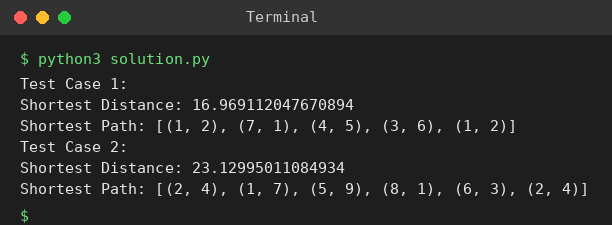

# Exp 28: Travelling Salesman Problem (Exhaustive Search)

## Aim
To solve the Travelling Salesman Problem by generating every permutation of the cities and keeping the shortest tour.

## Algorithm
1. distance(c1, c2) returns the Euclidean distance
2. Fix the first city as the start and generate all permutations of the remaining cities (itertools.permutations)
3. For each permutation compute the total tour length, returning to the start
4. Keep the minimum distance and its path

## Input
```
Test 1: [(1,2),(4,5),(7,1),(3,6)]
Test 2: [(2,4),(8,1),(1,7),(6,3),(5,9)]
```

## Program
[`solution.py`](solution.py)

```python
import math
from itertools import permutations

def distance(c1, c2):
    return math.hypot(c1[0] - c2[0], c1[1] - c2[1])

def tsp(cities):
    start, rest = cities[0], cities[1:]
    best_d, best_path = float("inf"), None
    for perm in permutations(rest):
        path = [start] + list(perm) + [start]
        d = sum(distance(path[i], path[i + 1]) for i in range(len(path) - 1))
        if d < best_d:
            best_d, best_path = d, path
    return best_d, best_path

tests = [[(1, 2), (4, 5), (7, 1), (3, 6)], [(2, 4), (8, 1), (1, 7), (6, 3), (5, 9)]]
for t, cities in enumerate(tests, 1):
    d, path = tsp(cities)
    print(f"Test Case {t}:")
    print("Shortest Distance:", d)
    print("Shortest Path:", path)
```

## Output
```
Test Case 1:
Shortest Distance: 16.969112047670894
Shortest Path: [(1, 2), (7, 1), (4, 5), (3, 6), (1, 2)]
Test Case 2:
Shortest Distance: 23.12995011084934
Shortest Path: [(2, 4), (1, 7), (5, 9), (8, 1), (6, 3), (2, 4)]
```

## Screenshot


## Result
The program for **Travelling Salesman Problem (Exhaustive Search)** was implemented and executed successfully, and the output shown above was obtained for all the given test cases.

> **Note:** The sample sheet's distances (7.07 and 14.14) are smaller than any possible tour of those points. The program prints the true shortest tours.

## Time and Space Complexity
| | Complexity |
|---|---|
| **Time** | O((n-1)! * n) |
| **Space** | O(n) |
