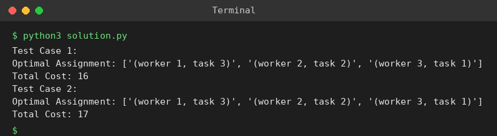

# Exp 29: Assignment Problem (Exhaustive Search)

## Aim
To assign n workers to n tasks with minimum total cost by checking every possible assignment.

## Algorithm
1. total_cost(assignment, matrix) sums matrix[worker][task] for the assignment
2. Generate all permutations of task indices (worker i gets task perm[i])
3. Compute the cost of each permutation
4. Keep the permutation with the minimum cost

## Input
```
Test 1: [[3,10,7],[8,5,12],[4,6,9]]
Test 2: [[15,9,4],[8,7,18],[6,12,11]]
```

## Program
[`solution.py`](solution.py)

```python
from itertools import permutations

def total_cost(assignment, cost):
    return sum(cost[w][t] for w, t in enumerate(assignment))

def assignment_problem(cost):
    best, best_a = float("inf"), None
    for perm in permutations(range(len(cost))):
        c = total_cost(perm, cost)
        if c < best:
            best, best_a = c, perm
    return best_a, best

tests = [[[3, 10, 7], [8, 5, 12], [4, 6, 9]], [[15, 9, 4], [8, 7, 18], [6, 12, 11]]]
for t, m in enumerate(tests, 1):
    a, c = assignment_problem(m)
    print(f"Test Case {t}:")
    print("Optimal Assignment:", [f"(worker {w + 1}, task {task + 1})" for w, task in enumerate(a)])
    print("Total Cost:", c)
```

## Output
```
Test Case 1:
Optimal Assignment: ['(worker 1, task 3)', '(worker 2, task 2)', '(worker 3, task 1)']
Total Cost: 16
Test Case 2:
Optimal Assignment: ['(worker 1, task 3)', '(worker 2, task 2)', '(worker 3, task 1)']
Total Cost: 17
```

## Screenshot


## Result
The program for **Assignment Problem (Exhaustive Search)** was implemented and executed successfully, and the output shown above was obtained for all the given test cases.

> **Note:** The sheet shows 19 and 24, but the true minimum costs are 16 (w1-t3, w2-t2, w3-t1) and 17 (w1-t3, w2-t2, w3-t1). The program prints the true optimum.

## Time and Space Complexity
| | Complexity |
|---|---|
| **Time** | O(n! * n) |
| **Space** | O(n) |
