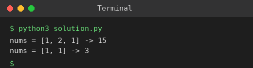

# Exp 3: Sum of Squares of Distinct Counts of Subarrays

## Aim
To return the sum of the squares of the distinct counts of all subarrays of an array.

## Algorithm
1. Fix the start index i of the subarray
2. Extend the end index j from i to n-1 while keeping a set of values seen
3. After adding nums[j], the distinct count is len(set); add its square to the total
4. Return the total

## Input
```
nums = [1,2,1]
nums = [1,1]
```

## Program
[`solution.py`](solution.py)

```python
def sum_counts(nums):
    n, total = len(nums), 0
    for i in range(n):
        seen = set()
        for j in range(i, n):
            seen.add(nums[j])
            total += len(seen) ** 2
    return total

for nums in ([1, 2, 1], [1, 1]):
    print("nums =", nums, "->", sum_counts(nums))
```

## Output
```
nums = [1, 2, 1] -> 15
nums = [1, 1] -> 3
```

## Screenshot


## Result
The program for **Sum of Squares of Distinct Counts of Subarrays** was implemented and executed successfully, and the output shown above was obtained for all the given test cases.

## Time and Space Complexity
| | Complexity |
|---|---|
| **Time** | O(n^2) |
| **Space** | O(n) |
