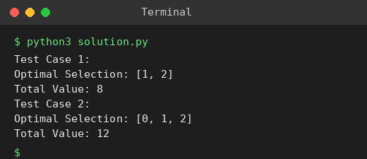

# Exp 30: 0-1 Knapsack (Exhaustive Search)

## Aim
To solve the 0-1 knapsack problem by examining every subset of items.

## Algorithm
1. total_value(items, values) sums the values of the selected items
2. is_feasible(items, weights, capacity) checks that the total weight does not exceed the capacity
3. Generate all 2^n subsets of item indices
4. Among feasible subsets keep the one with the maximum value

## Input
```
Test 1: weights [2,3,1], values [4,5,3], capacity 4
Test 2: weights [1,2,3,4], values [2,4,6,3], capacity 6
```

## Program
[`solution.py`](solution.py)

```python
from itertools import combinations

def total_value(items, values):
    return sum(values[i] for i in items)

def is_feasible(items, weights, capacity):
    return sum(weights[i] for i in items) <= capacity

def knapsack(weights, values, capacity):
    best, best_sel = -1, []
    n = len(weights)
    for r in range(n + 1):
        for items in combinations(range(n), r):
            if is_feasible(items, weights, capacity):
                v = total_value(items, values)
                if v > best:
                    best, best_sel = v, list(items)
    return best_sel, best

tests = [([2, 3, 1], [4, 5, 3], 4), ([1, 2, 3, 4], [2, 4, 6, 3], 6)]
for t, (w, v, c) in enumerate(tests, 1):
    sel, val = knapsack(w, v, c)
    print(f"Test Case {t}:")
    print("Optimal Selection:", sel)
    print("Total Value:", val)
```

## Output
```
Test Case 1:
Optimal Selection: [1, 2]
Total Value: 8
Test Case 2:
Optimal Selection: [0, 1, 2]
Total Value: 12
```

## Screenshot


## Result
The program for **0-1 Knapsack (Exhaustive Search)** was implemented and executed successfully, and the output shown above was obtained for all the given test cases.

> **Note:** The sheet shows 7 and 10, but better feasible selections exist: [1, 2] gives 8 in test 1 and [0, 1, 2] gives 12 in test 2. The program prints the true optimum.

## Time and Space Complexity
| | Complexity |
|---|---|
| **Time** | O(n * 2^n) |
| **Space** | O(n) |
