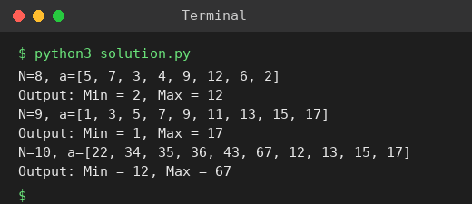

# Exp 31: Maximum and Minimum using Divide and Conquer

## Aim
To find both the maximum and minimum values of an array using divide and conquer.

## Algorithm
1. Divide the array into two halves
2. Recursively find min and max of each half (base cases: 1 or 2 elements)
3. Combine: min = smaller of the two minimums, max = larger of the two maximums
4. Return (min, max)

## Input
```
N=8, a[] = {5,7,3,4,9,12,6,2}
N=9, a[] = {1,3,5,7,9,11,13,15,17}
N=10, a[] = {22,34,35,36,43,67,12,13,15,17}
```

## Program
[`solution.py`](solution.py)

```python
def min_max(a, lo, hi):
    if lo == hi:
        return a[lo], a[lo]
    if hi == lo + 1:
        return (a[lo], a[hi]) if a[lo] < a[hi] else (a[hi], a[lo])
    mid = (lo + hi) // 2
    mn1, mx1 = min_max(a, lo, mid)
    mn2, mx2 = min_max(a, mid + 1, hi)
    return min(mn1, mn2), max(mx1, mx2)

for a in ([5, 7, 3, 4, 9, 12, 6, 2], [1, 3, 5, 7, 9, 11, 13, 15, 17], [22, 34, 35, 36, 43, 67, 12, 13, 15, 17]):
    mn, mx = min_max(a, 0, len(a) - 1)
    print(f"N={len(a)}, a={a}")
    print(f"Output: Min = {mn}, Max = {mx}")
```

## Output
```
N=8, a=[5, 7, 3, 4, 9, 12, 6, 2]
Output: Min = 2, Max = 12
N=9, a=[1, 3, 5, 7, 9, 11, 13, 15, 17]
Output: Min = 1, Max = 17
N=10, a=[22, 34, 35, 36, 43, 67, 12, 13, 15, 17]
Output: Min = 12, Max = 67
```

## Screenshot


## Result
The program for **Maximum and Minimum using Divide and Conquer** was implemented and executed successfully, and the output shown above was obtained for all the given test cases.

## Time and Space Complexity
| | Complexity |
|---|---|
| **Time** | O(n) (about 3n/2 - 2 comparisons) |
| **Space** | O(log n) recursion stack |
