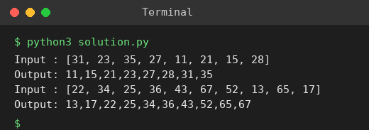

# Exp 33: Merge Sort

## Aim
To sort an array using merge sort (divide and conquer).

## Algorithm
1. Divide the array into two halves
2. Recursively sort each half
3. Merge the two sorted halves by repeatedly taking the smaller front element
4. A single element is already sorted (base case)

## Input
```
N=8, a[] = {31,23,35,27,11,21,15,28}
N=10, a[] = {22,34,25,36,43,67,52,13,65,17}
```

## Program
[`solution.py`](solution.py)

```python
def merge_sort(a):
    if len(a) <= 1:
        return a
    mid = len(a) // 2
    l, r = merge_sort(a[:mid]), merge_sort(a[mid:])
    out, i, j = [], 0, 0
    while i < len(l) and j < len(r):
        if l[i] <= r[j]:
            out.append(l[i]); i += 1
        else:
            out.append(r[j]); j += 1
    return out + l[i:] + r[j:]

for a in ([31, 23, 35, 27, 11, 21, 15, 28], [22, 34, 25, 36, 43, 67, 52, 13, 65, 17]):
    print("Input :", a)
    print("Output:", ",".join(map(str, merge_sort(a))))
```

## Output
```
Input : [31, 23, 35, 27, 11, 21, 15, 28]
Output: 11,15,21,23,27,28,31,35
Input : [22, 34, 25, 36, 43, 67, 52, 13, 65, 17]
Output: 13,17,22,25,34,36,43,52,65,67
```

## Screenshot


## Result
The program for **Merge Sort** was implemented and executed successfully, and the output shown above was obtained for all the given test cases.

## Time and Space Complexity
| | Complexity |
|---|---|
| **Time** | O(n log n) in all cases |
| **Space** | O(n) |
