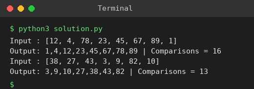

# Exp 34: Merge Sort with Comparison Count

## Aim
To implement merge sort and count the number of comparisons made while sorting.

## Algorithm
1. Implement merge sort recursively
2. Keep a counter that increases every time two elements are compared in the merge step
3. Sort the array
4. Print the sorted array and the number of comparisons

## Input
```
N=8, a[] = {12,4,78,23,45,67,89,1}
N=7, a[] = {38,27,43,3,9,82,10}
```

## Program
[`solution.py`](solution.py)

```python
count = 0

def merge_sort(a):
    global count
    if len(a) <= 1:
        return a
    mid = len(a) // 2
    l, r = merge_sort(a[:mid]), merge_sort(a[mid:])
    out, i, j = [], 0, 0
    while i < len(l) and j < len(r):
        count += 1
        if l[i] <= r[j]:
            out.append(l[i]); i += 1
        else:
            out.append(r[j]); j += 1
    return out + l[i:] + r[j:]

for a in ([12, 4, 78, 23, 45, 67, 89, 1], [38, 27, 43, 3, 9, 82, 10]):
    count = 0
    res = merge_sort(a)
    print("Input :", a)
    print("Output:", ",".join(map(str, res)), "| Comparisons =", count)
```

## Output
```
Input : [12, 4, 78, 23, 45, 67, 89, 1]
Output: 1,4,12,23,45,67,78,89 | Comparisons = 16
Input : [38, 27, 43, 3, 9, 82, 10]
Output: 3,9,10,27,38,43,82 | Comparisons = 13
```

## Screenshot


## Result
The program for **Merge Sort with Comparison Count** was implemented and executed successfully, and the output shown above was obtained for all the given test cases.

## Time and Space Complexity
| | Complexity |
|---|---|
| **Time** | O(n log n) |
| **Space** | O(n) |
