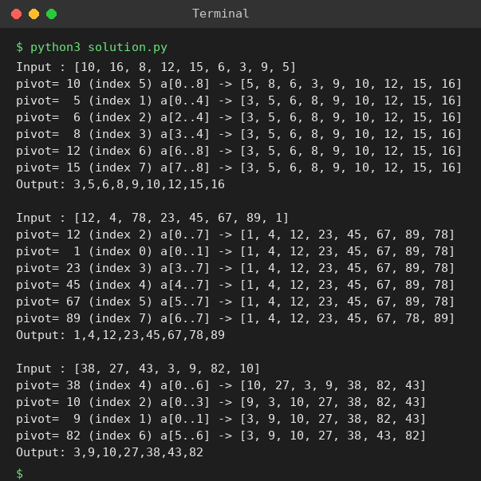

# Exp 35: Quick Sort (First Element as Pivot)

## Aim
To sort an array with quick sort choosing the first element as pivot and to display the array after every partition.

## Algorithm
1. Choose a[lo] as the pivot
2. Partition: move elements smaller than the pivot to its left and the rest to its right, then place the pivot in its final position
3. Print the array after the partition
4. Recursively quick sort the left and right sub-arrays

## Input
```
N=9, a[] = {10,16,8,12,15,6,3,9,5}
N=8, a[] = {12,4,78,23,45,67,89,1}
N=7, a[] = {38,27,43,3,9,82,10}
```

## Program
[`solution.py`](solution.py)

```python
def partition(a, lo, hi):
    pivot, i = a[lo], lo + 1
    for j in range(lo + 1, hi + 1):
        if a[j] < pivot:
            a[i], a[j] = a[j], a[i]
            i += 1
    a[lo], a[i - 1] = a[i - 1], a[lo]
    return i - 1

def quick_sort(a, lo, hi):
    if lo < hi:
        p = partition(a, lo, hi)
        print(f"pivot={a[p]:>3} (index {p}) a[{lo}..{hi}] -> {a}")
        quick_sort(a, lo, p - 1)
        quick_sort(a, p + 1, hi)

for a in ([10, 16, 8, 12, 15, 6, 3, 9, 5], [12, 4, 78, 23, 45, 67, 89, 1], [38, 27, 43, 3, 9, 82, 10]):
    print("Input :", a)
    quick_sort(a, 0, len(a) - 1)
    print("Output:", ",".join(map(str, a)), "\n")
```

## Output
```
Input : [10, 16, 8, 12, 15, 6, 3, 9, 5]
pivot= 10 (index 5) a[0..8] -> [5, 8, 6, 3, 9, 10, 12, 15, 16]
pivot=  5 (index 1) a[0..4] -> [3, 5, 6, 8, 9, 10, 12, 15, 16]
pivot=  6 (index 2) a[2..4] -> [3, 5, 6, 8, 9, 10, 12, 15, 16]
pivot=  8 (index 3) a[3..4] -> [3, 5, 6, 8, 9, 10, 12, 15, 16]
pivot= 12 (index 6) a[6..8] -> [3, 5, 6, 8, 9, 10, 12, 15, 16]
pivot= 15 (index 7) a[7..8] -> [3, 5, 6, 8, 9, 10, 12, 15, 16]
Output: 3,5,6,8,9,10,12,15,16 

Input : [12, 4, 78, 23, 45, 67, 89, 1]
pivot= 12 (index 2) a[0..7] -> [1, 4, 12, 23, 45, 67, 89, 78]
pivot=  1 (index 0) a[0..1] -> [1, 4, 12, 23, 45, 67, 89, 78]
pivot= 23 (index 3) a[3..7] -> [1, 4, 12, 23, 45, 67, 89, 78]
pivot= 45 (index 4) a[4..7] -> [1, 4, 12, 23, 45, 67, 89, 78]
pivot= 67 (index 5) a[5..7] -> [1, 4, 12, 23, 45, 67, 89, 78]
pivot= 89 (index 7) a[6..7] -> [1, 4, 12, 23, 45, 67, 78, 89]
Output: 1,4,12,23,45,67,78,89 

Input : [38, 27, 43, 3, 9, 82, 10]
pivot= 38 (index 4) a[0..6] -> [10, 27, 3, 9, 38, 82, 43]
pivot= 10 (index 2) a[0..3] -> [9, 3, 10, 27, 38, 82, 43]
pivot=  9 (index 1) a[0..1] -> [3, 9, 10, 27, 38, 82, 43]
pivot= 82 (index 6) a[5..6] -> [3, 9, 10, 27, 38, 43, 82]
Output: 3,9,10,27,38,43,82
```

## Screenshot


## Result
The program for **Quick Sort (First Element as Pivot)** was implemented and executed successfully, and the output shown above was obtained for all the given test cases.

## Time and Space Complexity
| | Complexity |
|---|---|
| **Time** | Best / average O(n log n), worst O(n^2) |
| **Space** | O(log n) average recursion stack |
