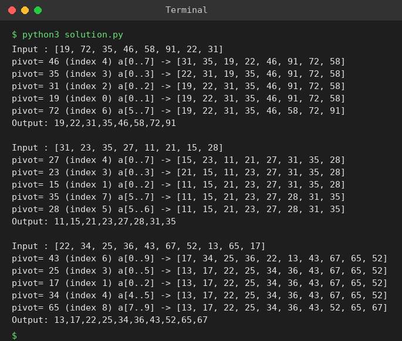

# Exp 36: Quick Sort (Middle Element as Pivot)

## Aim
To sort an array with quick sort choosing the middle element as pivot, displaying the array after each partition.

## Algorithm
1. Pick the middle element as the pivot and swap it to the front
2. Partition the sub-array around the pivot and place the pivot in its final position
3. Print the array after the partition
4. Recursively sort the left and right sub-arrays

## Input
```
N=8, a[] = {19,72,35,46,58,91,22,31}
N=8, a[] = {31,23,35,27,11,21,15,28}
N=10, a[] = {22,34,25,36,43,67,52,13,65,17}
```

## Program
[`solution.py`](solution.py)

```python
def partition(a, lo, hi):
    mid = (lo + hi) // 2
    a[lo], a[mid] = a[mid], a[lo]          # middle element becomes the pivot
    pivot, i = a[lo], lo + 1
    for j in range(lo + 1, hi + 1):
        if a[j] < pivot:
            a[i], a[j] = a[j], a[i]
            i += 1
    a[lo], a[i - 1] = a[i - 1], a[lo]
    return i - 1

def quick_sort(a, lo, hi):
    if lo < hi:
        p = partition(a, lo, hi)
        print(f"pivot={a[p]:>3} (index {p}) a[{lo}..{hi}] -> {a}")
        quick_sort(a, lo, p - 1)
        quick_sort(a, p + 1, hi)

for a in ([19, 72, 35, 46, 58, 91, 22, 31], [31, 23, 35, 27, 11, 21, 15, 28], [22, 34, 25, 36, 43, 67, 52, 13, 65, 17]):
    print("Input :", a)
    quick_sort(a, 0, len(a) - 1)
    print("Output:", ",".join(map(str, a)), "\n")
```

## Output
```
Input : [19, 72, 35, 46, 58, 91, 22, 31]
pivot= 46 (index 4) a[0..7] -> [31, 35, 19, 22, 46, 91, 72, 58]
pivot= 35 (index 3) a[0..3] -> [22, 31, 19, 35, 46, 91, 72, 58]
pivot= 31 (index 2) a[0..2] -> [19, 22, 31, 35, 46, 91, 72, 58]
pivot= 19 (index 0) a[0..1] -> [19, 22, 31, 35, 46, 91, 72, 58]
pivot= 72 (index 6) a[5..7] -> [19, 22, 31, 35, 46, 58, 72, 91]
Output: 19,22,31,35,46,58,72,91 

Input : [31, 23, 35, 27, 11, 21, 15, 28]
pivot= 27 (index 4) a[0..7] -> [15, 23, 11, 21, 27, 31, 35, 28]
pivot= 23 (index 3) a[0..3] -> [21, 15, 11, 23, 27, 31, 35, 28]
pivot= 15 (index 1) a[0..2] -> [11, 15, 21, 23, 27, 31, 35, 28]
pivot= 35 (index 7) a[5..7] -> [11, 15, 21, 23, 27, 28, 31, 35]
pivot= 28 (index 5) a[5..6] -> [11, 15, 21, 23, 27, 28, 31, 35]
Output: 11,15,21,23,27,28,31,35 

Input : [22, 34, 25, 36, 43, 67, 52, 13, 65, 17]
pivot= 43 (index 6) a[0..9] -> [17, 34, 25, 36, 22, 13, 43, 67, 65, 52]
pivot= 25 (index 3) a[0..5] -> [13, 17, 22, 25, 34, 36, 43, 67, 65, 52]
pivot= 17 (index 1) a[0..2] -> [13, 17, 22, 25, 34, 36, 43, 67, 65, 52]
pivot= 34 (index 4) a[4..5] -> [13, 17, 22, 25, 34, 36, 43, 67, 65, 52]
pivot= 65 (index 8) a[7..9] -> [13, 17, 22, 25, 34, 36, 43, 52, 65, 67]
Output: 13,17,22,25,34,36,43,52,65,67
```

## Screenshot


## Result
The program for **Quick Sort (Middle Element as Pivot)** was implemented and executed successfully, and the output shown above was obtained for all the given test cases.

## Time and Space Complexity
| | Complexity |
|---|---|
| **Time** | Best / average O(n log n), worst O(n^2) |
| **Space** | O(log n) average recursion stack |
