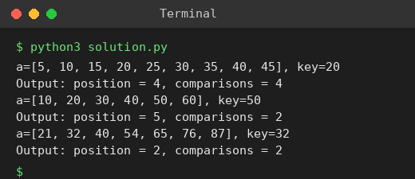

# Exp 37: Binary Search with Comparison Count

## Aim
To search an element with binary search and count the comparisons made.

## Algorithm
1. low = 0, high = n-1
2. mid = (low + high) // 2 and compare a[mid] with the key (count one comparison)
3. If equal return mid+1 (position), if key is larger search the right half, else the left half
4. Print the position and the comparison count

## Input
```
a[] = {5,10,15,20,25,30,35,40,45}, key = 20
a[] = {10,20,30,40,50,60}, key = 50
a[] = {21,32,40,54,65,76,87}, key = 32
```

## Program
[`solution.py`](solution.py)

```python
def binary_search(a, key):
    low, high, comps = 0, len(a) - 1, 0
    while low <= high:
        mid = (low + high) // 2
        comps += 1
        if a[mid] == key:
            return mid + 1, comps
        if a[mid] < key:
            low = mid + 1
        else:
            high = mid - 1
    return -1, comps

for a, key in (([5, 10, 15, 20, 25, 30, 35, 40, 45], 20), ([10, 20, 30, 40, 50, 60], 50), ([21, 32, 40, 54, 65, 76, 87], 32)):
    pos, c = binary_search(a, key)
    print(f"a={a}, key={key}")
    print(f"Output: position = {pos}, comparisons = {c}")
```

## Output
```
a=[5, 10, 15, 20, 25, 30, 35, 40, 45], key=20
Output: position = 4, comparisons = 4
a=[10, 20, 30, 40, 50, 60], key=50
Output: position = 5, comparisons = 2
a=[21, 32, 40, 54, 65, 76, 87], key=32
Output: position = 2, comparisons = 2
```

## Screenshot


## Result
The program for **Binary Search with Comparison Count** was implemented and executed successfully, and the output shown above was obtained for all the given test cases.

> **Note:** Position is 1-based (index + 1), which matches the expected outputs 4, 5 and 2.

## Time and Space Complexity
| | Complexity |
|---|---|
| **Time** | O(log n) |
| **Space** | O(1) |
