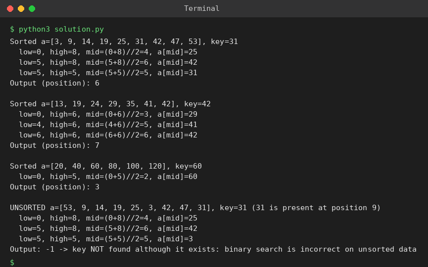

# Exp 38: Binary Search: Mid-point Steps and Effect of an Unsorted Array

## Aim
To trace the mid-point calculations of binary search and show why it fails on an unsorted array.

## Algorithm
1. Run binary search on the sorted array and print low, high, mid and a[mid] at every step
2. Report the 1-based position of the key
3. Run the same search on an unsorted array containing the key
4. Observe that the key is missed, so sortedness is required for correctness

## Input
```
a[] = {3,9,14,19,25,31,42,47,53}, key = 31
a[] = {13,19,24,29,35,41,42}, key = 42
a[] = {20,40,60,80,100,120}, key = 60
Unsorted: {53,9,14,19,25,3,42,47,31}, key = 31
```

## Program
[`solution.py`](solution.py)

```python
def binary_search(a, key, show=True):
    low, high = 0, len(a) - 1
    while low <= high:
        mid = (low + high) // 2
        if show:
            print(f"  low={low}, high={high}, mid=({low}+{high})//2={mid}, a[mid]={a[mid]}")
        if a[mid] == key:
            return mid + 1
        if a[mid] < key:
            low = mid + 1
        else:
            high = mid - 1
    return -1

for a, key in (([3, 9, 14, 19, 25, 31, 42, 47, 53], 31), ([13, 19, 24, 29, 35, 41, 42], 42), ([20, 40, 60, 80, 100, 120], 60)):
    print(f"Sorted a={a}, key={key}")
    print("Output (position):", binary_search(a, key), "\n")

u = [53, 9, 14, 19, 25, 3, 42, 47, 31]
print(f"UNSORTED a={u}, key=31 (31 is present at position 9)")
r = binary_search(u, 31)
print("Output:", r if r != -1 else "-1 -> key NOT found although it exists: binary search is incorrect on unsorted data")
```

## Output
```
Sorted a=[3, 9, 14, 19, 25, 31, 42, 47, 53], key=31
  low=0, high=8, mid=(0+8)//2=4, a[mid]=25
  low=5, high=8, mid=(5+8)//2=6, a[mid]=42
  low=5, high=5, mid=(5+5)//2=5, a[mid]=31
Output (position): 6 

Sorted a=[13, 19, 24, 29, 35, 41, 42], key=42
  low=0, high=6, mid=(0+6)//2=3, a[mid]=29
  low=4, high=6, mid=(4+6)//2=5, a[mid]=41
  low=6, high=6, mid=(6+6)//2=6, a[mid]=42
Output (position): 7 

Sorted a=[20, 40, 60, 80, 100, 120], key=60
  low=0, high=5, mid=(0+5)//2=2, a[mid]=60
Output (position): 3 

UNSORTED a=[53, 9, 14, 19, 25, 3, 42, 47, 31], key=31 (31 is present at position 9)
  low=0, high=8, mid=(0+8)//2=4, a[mid]=25
  low=5, high=8, mid=(5+8)//2=6, a[mid]=42
  low=5, high=5, mid=(5+5)//2=5, a[mid]=3
Output: -1 -> key NOT found although it exists: binary search is incorrect on unsorted data
```

## Screenshot


## Result
The program for **Binary Search: Mid-point Steps and Effect of an Unsorted Array** was implemented and executed successfully, and the output shown above was obtained for all the given test cases.

## Time and Space Complexity
| | Complexity |
|---|---|
| **Time** | O(log n) |
| **Space** | O(1) |
