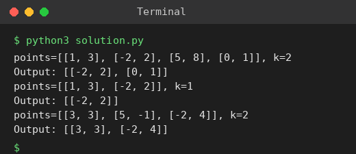

# Exp 39: K Closest Points to the Origin

## Aim
To return the k points closest to the origin (0, 0).

## Algorithm
1. Compute the squared distance x^2 + y^2 of every point (no square root needed)
2. Sort the points by this distance
3. Take the first k points
4. Return them in their original input order

## Input
```
points = [[1,3],[-2,2],[5,8],[0,1]], k = 2
points = [[1,3],[-2,2]], k = 1
points = [[3,3],[5,-1],[-2,4]], k = 2
```

## Program
[`solution.py`](solution.py)

```python
def k_closest(points, k):
    order = sorted(range(len(points)), key=lambda i: points[i][0] ** 2 + points[i][1] ** 2)[:k]
    return [points[i] for i in sorted(order)]

for pts, k in (([[1, 3], [-2, 2], [5, 8], [0, 1]], 2), ([[1, 3], [-2, 2]], 1), ([[3, 3], [5, -1], [-2, 4]], 2)):
    print(f"points={pts}, k={k}")
    print("Output:", k_closest(pts, k))
```

## Output
```
points=[[1, 3], [-2, 2], [5, 8], [0, 1]], k=2
Output: [[-2, 2], [0, 1]]
points=[[1, 3], [-2, 2]], k=1
Output: [[-2, 2]]
points=[[3, 3], [5, -1], [-2, 4]], k=2
Output: [[3, 3], [-2, 4]]
```

## Screenshot


## Result
The program for **K Closest Points to the Origin** was implemented and executed successfully, and the output shown above was obtained for all the given test cases.

## Time and Space Complexity
| | Complexity |
|---|---|
| **Time** | O(n log n) |
| **Space** | O(n) |
