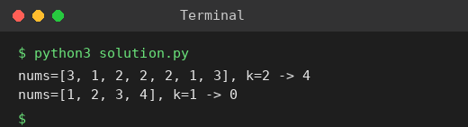

# Exp 4: Count Equal Pairs with (i * j) Divisible by k

## Aim
To count pairs (i, j), i < j, such that nums[i] == nums[j] and (i * j) is divisible by k.

## Algorithm
1. Group the indices of equal values using a hash map
2. For every group, check each pair of indices (a < b)
3. Count the pair if (a * b) % k == 0
4. Return the count

## Input
```
nums = [3,1,2,2,2,1,3], k = 2
nums = [1,2,3,4], k = 1
```

## Program
[`solution.py`](solution.py)

```python
from collections import defaultdict

def count_pairs(nums, k):
    pos = defaultdict(list)
    for i, v in enumerate(nums):
        pos[v].append(i)
    cnt = 0
    for idx in pos.values():
        for a in range(len(idx)):
            for b in range(a + 1, len(idx)):
                if (idx[a] * idx[b]) % k == 0:
                    cnt += 1
    return cnt

for nums, k in (([3, 1, 2, 2, 2, 1, 3], 2), ([1, 2, 3, 4], 1)):
    print(f"nums={nums}, k={k} -> {count_pairs(nums, k)}")
```

## Output
```
nums=[3, 1, 2, 2, 2, 1, 3], k=2 -> 4
nums=[1, 2, 3, 4], k=1 -> 0
```

## Screenshot


## Result
The program for **Count Equal Pairs with (i * j) Divisible by k** was implemented and executed successfully, and the output shown above was obtained for all the given test cases.

## Time and Space Complexity
| | Complexity |
|---|---|
| **Time** | O(n^2) worst case (all values equal), O(n) when values are distinct |
| **Space** | O(n) |
