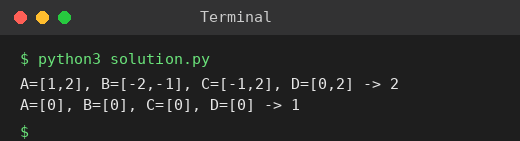

# Exp 40: 4Sum II (Count Tuples with Zero Sum)

## Aim
To count tuples (i, j, k, l) such that A[i] + B[j] + C[k] + D[l] = 0.

## Algorithm
1. Store the frequency of every sum A[i] + B[j] in a hash map
2. For every pair C[k] + D[l] add the frequency of -(C[k] + D[l])
3. Return the total count

## Input
```
A=[1,2], B=[-2,-1], C=[-1,2], D=[0,2]
A=[0], B=[0], C=[0], D=[0]
```

## Program
[`solution.py`](solution.py)

```python
from collections import Counter

def four_sum_count(A, B, C, D):
    ab = Counter(a + b for a in A for b in B)
    return sum(ab[-(c + d)] for c in C for d in D)

print("A=[1,2], B=[-2,-1], C=[-1,2], D=[0,2] ->", four_sum_count([1, 2], [-2, -1], [-1, 2], [0, 2]))
print("A=[0], B=[0], C=[0], D=[0] ->", four_sum_count([0], [0], [0], [0]))
```

## Output
```
A=[1,2], B=[-2,-1], C=[-1,2], D=[0,2] -> 2
A=[0], B=[0], C=[0], D=[0] -> 1
```

## Screenshot


## Result
The program for **4Sum II (Count Tuples with Zero Sum)** was implemented and executed successfully, and the output shown above was obtained for all the given test cases.

## Time and Space Complexity
| | Complexity |
|---|---|
| **Time** | O(n^2) |
| **Space** | O(n^2) |
