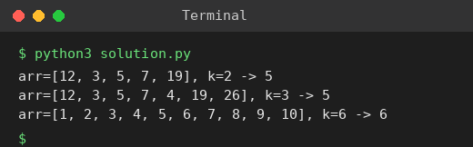

# Exp 41: Median of Medians (k-th Smallest Element)

## Aim
To find the k-th smallest element of an unsorted array in worst-case linear time using the median of medians algorithm.

## Algorithm
1. Divide the array into groups of 5 and sort each group
2. Take the median of every group and recursively find the median of these medians (the pivot)
3. Partition the array into elements smaller than, equal to and greater than the pivot
4. Recurse only into the part that contains the k-th smallest element

## Input
```
arr = [12,3,5,7,19], k = 2
arr = [12,3,5,7,4,19,26], k = 3
arr = [1,2,3,4,5,6,7,8,9,10], k = 6
```

## Program
[`solution.py`](solution.py)

```python
def median_of_medians(arr, k):          # k is 1-based
    if len(arr) <= 5:
        return sorted(arr)[k - 1]
    groups = [sorted(arr[i:i + 5]) for i in range(0, len(arr), 5)]
    medians = [g[len(g) // 2] for g in groups]
    pivot = median_of_medians(medians, (len(medians) + 1) // 2)
    low = [x for x in arr if x < pivot]
    eq = [x for x in arr if x == pivot]
    high = [x for x in arr if x > pivot]
    if k <= len(low):
        return median_of_medians(low, k)
    if k <= len(low) + len(eq):
        return pivot
    return median_of_medians(high, k - len(low) - len(eq))

for arr, k in (([12, 3, 5, 7, 19], 2), ([12, 3, 5, 7, 4, 19, 26], 3), ([1, 2, 3, 4, 5, 6, 7, 8, 9, 10], 6)):
    print(f"arr={arr}, k={k} -> {median_of_medians(arr, k)}")
```

## Output
```
arr=[12, 3, 5, 7, 19], k=2 -> 5
arr=[12, 3, 5, 7, 4, 19, 26], k=3 -> 5
arr=[1, 2, 3, 4, 5, 6, 7, 8, 9, 10], k=6 -> 6
```

## Screenshot


## Result
The program for **Median of Medians (k-th Smallest Element)** was implemented and executed successfully, and the output shown above was obtained for all the given test cases.

## Time and Space Complexity
| | Complexity |
|---|---|
| **Time** | O(n) worst case |
| **Space** | O(n) (O(log n) with an in-place partition) |
