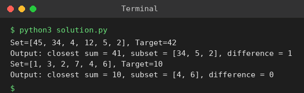

# Exp 43: Meet in the Middle: Subset Sum Closest to a Target

## Aim
To find the subset whose sum is closest to a target using the meet in the middle technique.

## Algorithm
1. Split the set into two halves
2. Generate all subset sums of each half (2^(n/2) each)
3. Sort the sums of the second half
4. For every sum s of the first half binary search the value closest to (target - s) in the second half and keep the best total

## Input
```
Set = {45,34,4,12,5,2}, Target = 42
Set = {1,3,2,7,4,6}, Target = 10
```

## Program
[`solution.py`](solution.py)

```python
from bisect import bisect_left

def subset_sums(items):
    sums = [(0, [])]
    for x in items:
        sums += [(s + x, sub + [x]) for s, sub in sums]
    return sums

def closest_subset(arr, target):
    half = len(arr) // 2
    L, R = subset_sums(arr[:half]), subset_sums(arr[half:])
    R.sort(key=lambda t: t[0])
    Rs = [t[0] for t in R]
    best = None
    for s, sub in L:
        p = bisect_left(Rs, target - s)
        for q in (p - 1, p):
            if 0 <= q < len(R):
                tot = s + R[q][0]
                if best is None or abs(tot - target) < abs(best[0] - target):
                    best = (tot, sub + R[q][1])
    return best

for arr, t in (([45, 34, 4, 12, 5, 2], 42), ([1, 3, 2, 7, 4, 6], 10)):
    tot, sub = closest_subset(arr, t)
    print(f"Set={arr}, Target={t}")
    print(f"Output: closest sum = {tot}, subset = {sub}, difference = {abs(tot - t)}")
```

## Output
```
Set=[45, 34, 4, 12, 5, 2], Target=42
Output: closest sum = 41, subset = [34, 5, 2], difference = 1
Set=[1, 3, 2, 7, 4, 6], Target=10
Output: closest sum = 10, subset = [4, 6], difference = 0
```

## Screenshot


## Result
The program for **Meet in the Middle: Subset Sum Closest to a Target** was implemented and executed successfully, and the output shown above was obtained for all the given test cases.

## Time and Space Complexity
| | Complexity |
|---|---|
| **Time** | O(2^(n/2) * n) |
| **Space** | O(2^(n/2)) |
