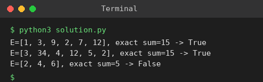

# Exp 44: Meet in the Middle: Exact Subset Sum

## Aim
To decide whether any subset of a large array sums exactly to E using meet in the middle.

## Algorithm
1. Split the array into two halves and generate the subset sums of each half
2. Store the sums of the second half in a hash set
3. For every sum s of the first half check whether (E - s) is in the set
4. Return True if found, otherwise False

## Input
```
E = {1,3,9,2,7,12}, exact sum = 15
E = {3,34,4,12,5,2}, exact sum = 15
```

## Program
[`solution.py`](solution.py)

```python
def subset_sums(items):
    sums = [0]
    for x in items:
        sums += [s + x for s in sums]
    return sums

def subset_sum_exists(arr, target):
    half = len(arr) // 2
    left = subset_sums(arr[:half])
    right = set(subset_sums(arr[half:]))
    return any(target - s in right for s in left)

for arr, t in (([1, 3, 9, 2, 7, 12], 15), ([3, 34, 4, 12, 5, 2], 15), ([2, 4, 6], 5)):
    print(f"E={arr}, exact sum={t} -> {subset_sum_exists(arr, t)}")
```

## Output
```
E=[1, 3, 9, 2, 7, 12], exact sum=15 -> True
E=[3, 34, 4, 12, 5, 2], exact sum=15 -> True
E=[2, 4, 6], exact sum=5 -> False
```

## Screenshot


## Result
The program for **Meet in the Middle: Exact Subset Sum** was implemented and executed successfully, and the output shown above was obtained for all the given test cases.

## Time and Space Complexity
| | Complexity |
|---|---|
| **Time** | O(2^(n/2)) |
| **Space** | O(2^(n/2)) |
