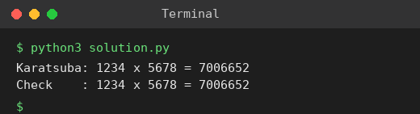

# Exp 46: Karatsuba Multiplication

## Aim
To multiply two large integers with the Karatsuba algorithm.

## Algorithm
1. If either number has one digit multiply directly
2. Split x = a*10^m + b and y = c*10^m + d at m = n/2 digits
3. Compute ac, bd and (a+b)(c+d) with three recursive multiplications
4. Result = ac*10^(2m) + ((a+b)(c+d) - ac - bd)*10^m + bd

## Input
```
x = 1234, y = 5678
```

## Program
[`solution.py`](solution.py)

```python
def karatsuba(x, y):
    if x < 10 or y < 10:
        return x * y
    n = max(len(str(x)), len(str(y)))
    m = n // 2
    p = 10 ** m
    a, b = divmod(x, p)
    c, d = divmod(y, p)
    ac, bd = karatsuba(a, c), karatsuba(b, d)
    mid = karatsuba(a + b, c + d) - ac - bd
    return ac * p * p + mid * p + bd

x, y = 1234, 5678
print(f"Karatsuba: {x} x {y} = {karatsuba(x, y)}")
print(f"Check    : {x} x {y} = {x * y}")
```

## Output
```
Karatsuba: 1234 x 5678 = 7006652
Check    : 1234 x 5678 = 7006652
```

## Screenshot


## Result
The program for **Karatsuba Multiplication** was implemented and executed successfully, and the output shown above was obtained for all the given test cases.

> **Note:** The sheet shows 7016652, but 1234 x 5678 = 7006652. The program prints the correct product.

## Time and Space Complexity
| | Complexity |
|---|---|
| **Time** | O(n^1.585) |
| **Space** | O(n) recursion depth O(log n) |
