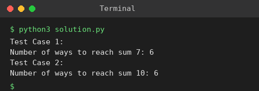

# Exp 47: Dice Throw Problem

## Aim
To count the ways to get a target sum when throwing a number of dice with a given number of sides, using dynamic programming.

## Algorithm
1. dp[d][s] = number of ways to get sum s with d dice
2. dp[0][0] = 1
3. dp[d][s] = sum of dp[d-1][s-f] for face f = 1..sides
4. Answer is dp[num_dice][target]

## Input
```
Test 1: sides = 6, dice = 2, target = 7
Test 2: sides = 4, dice = 3, target = 10
```

## Program
[`solution.py`](solution.py)

```python
def dice_throw(sides, dice, target):
    dp = [[0] * (target + 1) for _ in range(dice + 1)]
    dp[0][0] = 1
    for d in range(1, dice + 1):
        for s in range(1, target + 1):
            dp[d][s] = sum(dp[d - 1][s - f] for f in range(1, min(sides, s) + 1))
    return dp[dice][target]

for t, (sides, dice, target) in enumerate(((6, 2, 7), (4, 3, 10)), 1):
    print(f"Test Case {t}:")
    print(f"Number of ways to reach sum {target}: {dice_throw(sides, dice, target)}")
```

## Output
```
Test Case 1:
Number of ways to reach sum 7: 6
Test Case 2:
Number of ways to reach sum 10: 6
```

## Screenshot


## Result
The program for **Dice Throw Problem** was implemented and executed successfully, and the output shown above was obtained for all the given test cases.

> **Note:** For 4-sided dice x 3 and target 10 the correct count is 6 ((2,4,4) and (3,3,4) with their permutations), not 27 as in the sheet.

## Time and Space Complexity
| | Complexity |
|---|---|
| **Time** | O(dice * target * sides) |
| **Space** | O(dice * target) |
