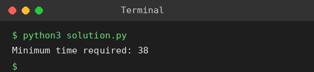

# Exp 48: Assembly Line Scheduling (2 Lines)

## Aim
To find the minimum time to process a product through two assembly lines with transfer times.

## Algorithm
1. f1[i], f2[i] = fastest time to finish station i on line 1 / line 2
2. f1[0] = e1 + a1[0], f2[0] = e2 + a2[0]
3. f1[i] = min(f1[i-1], f2[i-1] + t2[i-1]) + a1[i] and f2[i] = min(f2[i-1], f1[i-1] + t1[i-1]) + a2[i]
4. Answer = min(f1[n-1] + x1, f2[n-1] + x2)

## Input
```
n=6, a1=[7,9,3,4,8,4], a2=[8,5,6,4,5,7]
t1=[2,3,1,3,4], t2=[2,1,2,2,1]
e1=2, e2=4, x1=3, x2=6
```

## Program
[`solution.py`](solution.py)

```python
def assembly_line(a1, a2, t1, t2, e1, e2, x1, x2):
    n = len(a1)
    f1, f2 = e1 + a1[0], e2 + a2[0]
    for i in range(1, n):
        f1, f2 = (min(f1, f2 + t2[i - 1]) + a1[i],
                  min(f2, f1 + t1[i - 1]) + a2[i])
    return min(f1 + x1, f2 + x2)

a1, a2 = [7, 9, 3, 4, 8, 4], [8, 5, 6, 4, 5, 7]
t1, t2 = [2, 3, 1, 3, 4], [2, 1, 2, 2, 1]
print("Minimum time required:", assembly_line(a1, a2, t1, t2, 2, 4, 3, 6))
```

## Output
```
Minimum time required: 38
```

## Screenshot


## Result
The program for **Assembly Line Scheduling (2 Lines)** was implemented and executed successfully, and the output shown above was obtained for all the given test cases.

## Time and Space Complexity
| | Complexity |
|---|---|
| **Time** | O(n) |
| **Space** | O(1) |
