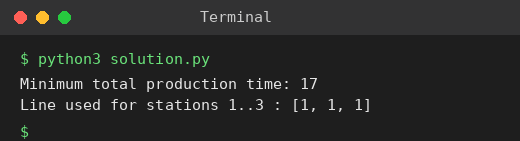

# Exp 49: Assembly Scheduling with Three Lines and Dependencies

## Aim
To minimise the total production time over 3 assembly lines with transfer times and sequential dependencies.

## Algorithm
1. dp[s][l] = minimum time to finish station s on line l
2. dp[0][l] = time[l][0]
3. dp[s][l] = time[l][s] + min over previous line p of (dp[s-1][p] + transfer[p][l]) (the dependency forces station s to start after station s-1)
4. Answer = min over l of dp[last][l]

## Input
```
Stations = 3
Line 1: [5,9,3], Line 2: [6,8,4], Line 3: [7,6,5]
Transfer = [[0,2,3],[2,0,4],[3,4,0]]
Dependencies: [(0,1),(1,2)]
```

## Program
[`solution.py`](solution.py)

```python
def schedule(times, transfer):
    L, S = len(times), len(times[0])
    dp = [[0] * L for _ in range(S)]
    par = [[-1] * L for _ in range(S)]
    for l in range(L):
        dp[0][l] = times[l][0]
    for s in range(1, S):
        for l in range(L):
            cost, p = min((dp[s - 1][p] + transfer[p][l], p) for p in range(L))
            dp[s][l] = times[l][s] + cost
            par[s][l] = p
    last = min(range(L), key=lambda l: dp[S - 1][l])
    best, route, l = dp[S - 1][last], [], last
    for s in range(S - 1, -1, -1):
        route.append(l + 1)
        l = par[s][l]
    return best, route[::-1]

times = [[5, 9, 3], [6, 8, 4], [7, 6, 5]]
transfer = [[0, 2, 3], [2, 0, 4], [3, 4, 0]]
best, route = schedule(times, transfer)
print("Minimum total production time:", best)
print("Line used for stations 1..3 :", route)
```

## Output
```
Minimum total production time: 17
Line used for stations 1..3 : [1, 1, 1]
```

## Screenshot


## Result
The program for **Assembly Scheduling with Three Lines and Dependencies** was implemented and executed successfully, and the output shown above was obtained for all the given test cases.

## Time and Space Complexity
| | Complexity |
|---|---|
| **Time** | O(stations * lines^2) |
| **Space** | O(stations * lines) |
