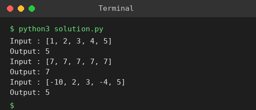

# Exp 5: Maximum Element of an Array (Least Time Complexity)

## Aim
To find the largest element of an array with the least possible time complexity.

## Algorithm
1. Assume the first element is the maximum
2. Scan the remaining elements once
3. Update the maximum whenever a larger element is found
4. Return the maximum

## Input
```
{1,2,3,4,5}
{7,7,7,7,7}
{-10,2,3,-4,5}
```

## Program
[`solution.py`](solution.py)

```python
def find_max(a):
    m = a[0]
    for x in a[1:]:
        if x > m:
            m = x
    return m

for a in ([1, 2, 3, 4, 5], [7, 7, 7, 7, 7], [-10, 2, 3, -4, 5]):
    print("Input :", a)
    print("Output:", find_max(a))
```

## Output
```
Input : [1, 2, 3, 4, 5]
Output: 5
Input : [7, 7, 7, 7, 7]
Output: 7
Input : [-10, 2, 3, -4, 5]
Output: 5
```

## Screenshot


## Result
The program for **Maximum Element of an Array (Least Time Complexity)** was implemented and executed successfully, and the output shown above was obtained for all the given test cases.

## Time and Space Complexity
| | Complexity |
|---|---|
| **Time** | O(n) - a single pass is optimal |
| **Space** | O(1) |
