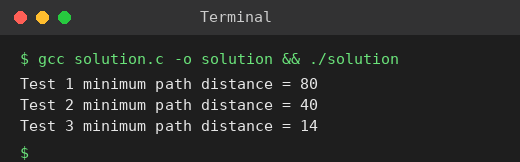

# Exp 50: Minimum Path Distance (Travelling Salesman by DP on a Distance Matrix) in C

## Aim
To write a C program that finds the minimum tour distance from a distance matrix using dynamic programming (Held-Karp).

## Algorithm
1. dp[mask][i] = minimum cost to start at city 0, visit the cities in 'mask' and end at city i
2. Initialise dp[1][0] = 0
3. Transition: dp[mask
4. (1<<j)][j] = min(dp[mask][i] + d[i][j]) for j not in mask
5. Answer = min over i of dp[full][i] + d[i][0]

## Input
```
Matrix 1: {0,10,15,20},{10,0,35,25},{15,35,0,30},{20,25,30,0}
Matrix 2: all off-diagonal entries 10
Matrix 3: {0,1,2,3},{1,0,4,5},{2,4,0,6},{3,5,6,0}
```

## Program
[`solution.c`](solution.c)

```c
#include <stdio.h>
#define N 4
#define INF 1000000000

int tsp(int d[N][N]) {
    static int dp[1 << N][N];
    for (int m = 0; m < (1 << N); m++)
        for (int i = 0; i < N; i++) dp[m][i] = INF;
    dp[1][0] = 0;
    for (int m = 1; m < (1 << N); m++)
        for (int i = 0; i < N; i++) {
            if (!(m & (1 << i)) || dp[m][i] == INF) continue;
            for (int j = 0; j < N; j++)
                if (!(m & (1 << j)) && dp[m][i] + d[i][j] < dp[m | (1 << j)][j])
                    dp[m | (1 << j)][j] = dp[m][i] + d[i][j];
        }
    int best = INF;
    for (int i = 1; i < N; i++)
        if (dp[(1 << N) - 1][i] + d[i][0] < best) best = dp[(1 << N) - 1][i] + d[i][0];
    return best;
}

int main() {
    int t1[N][N] = {{0,10,15,20},{10,0,35,25},{15,35,0,30},{20,25,30,0}};
    int t2[N][N] = {{0,10,10,10},{10,0,10,10},{10,10,0,10},{10,10,10,0}};
    int t3[N][N] = {{0,1,2,3},{1,0,4,5},{2,4,0,6},{3,5,6,0}};
    printf("Test 1 minimum path distance = %d\n", tsp(t1));
    printf("Test 2 minimum path distance = %d\n", tsp(t2));
    printf("Test 3 minimum path distance = %d\n", tsp(t3));
    return 0;
}
```

## Output
```
Test 1 minimum path distance = 80
Test 2 minimum path distance = 40
Test 3 minimum path distance = 14
```

## Screenshot


## Result
The program for **Minimum Path Distance (Travelling Salesman by DP on a Distance Matrix) in C** was implemented and executed successfully, and the output shown above was obtained for all the given test cases.

> **Note:** Test 3: every tour of that matrix costs at least 14 (e.g. 0-1-2-3-0 = 1+4+6+3), so the true minimum is 14, not 12 as listed in the sheet. Tests 1 and 2 give 80 and 40.

## Time and Space Complexity
| | Complexity |
|---|---|
| **Time** | O(n^2 * 2^n) |
| **Space** | O(n * 2^n) |
