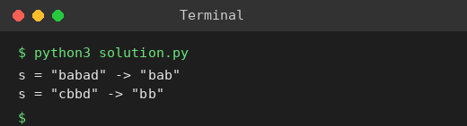

# Exp 52: Longest Palindromic Substring

## Aim
To return the longest palindromic substring of a string.

## Algorithm
1. Treat every index (and every gap between two indices) as a palindrome centre
2. Expand left and right while the characters match
3. Track the longest palindrome found
4. Return it

## Input
```
s = "babad"
s = "cbbd"
```

## Program
[`solution.py`](solution.py)

```python
def longest_palindrome(s):
    best = ""
    for c in range(len(s)):
        for l, r in ((c, c), (c, c + 1)):
            while l >= 0 and r < len(s) and s[l] == s[r]:
                l -= 1
                r += 1
            if r - l - 1 > len(best):
                best = s[l + 1:r]
    return best

for s in ("babad", "cbbd"):
    print(f's = "{s}" -> "{longest_palindrome(s)}"')
```

## Output
```
s = "babad" -> "bab"
s = "cbbd" -> "bb"
```

## Screenshot


## Result
The program for **Longest Palindromic Substring** was implemented and executed successfully, and the output shown above was obtained for all the given test cases.

## Time and Space Complexity
| | Complexity |
|---|---|
| **Time** | O(n^2) |
| **Space** | O(1) |
