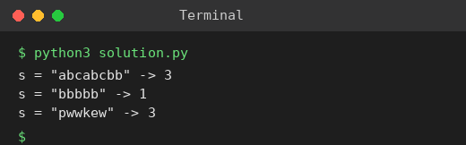

# Exp 53: Longest Substring Without Repeating Characters

## Aim
To find the length of the longest substring without repeating characters.

## Algorithm
1. Keep a window [left, right] and a map of the last index of each character
2. Move right over the string; if s[right] was seen inside the window, move left past its last index
3. Update the last index and the best window length
4. Return the best length

## Input
```
s = "abcabcbb"
s = "bbbbb"
s = "pwwkew"
```

## Program
[`solution.py`](solution.py)

```python
def length_of_longest_substring(s):
    last, left, best = {}, 0, 0
    for right, ch in enumerate(s):
        if ch in last and last[ch] >= left:
            left = last[ch] + 1
        last[ch] = right
        best = max(best, right - left + 1)
    return best

for s in ("abcabcbb", "bbbbb", "pwwkew"):
    print(f's = "{s}" -> {length_of_longest_substring(s)}')
```

## Output
```
s = "abcabcbb" -> 3
s = "bbbbb" -> 1
s = "pwwkew" -> 3
```

## Screenshot


## Result
The program for **Longest Substring Without Repeating Characters** was implemented and executed successfully, and the output shown above was obtained for all the given test cases.

## Time and Space Complexity
| | Complexity |
|---|---|
| **Time** | O(n) |
| **Space** | O(min(n, alphabet)) |
