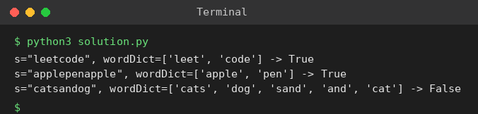

# Exp 54: Word Break

## Aim
To decide whether a string can be segmented into a sequence of dictionary words.

## Algorithm
1. dp[i] = True if the prefix s[:i] can be segmented, dp[0] = True
2. For each i check every j < i with dp[j] True and s[j:i] in the dictionary
3. Set dp[i] = True when such a j exists
4. Answer is dp[n]

## Input
```
s = "leetcode", wordDict = ["leet","code"]
s = "applepenapple", wordDict = ["apple","pen"]
s = "catsandog", wordDict = ["cats","dog","sand","and","cat"]
```

## Program
[`solution.py`](solution.py)

```python
def word_break(s, words):
    words = set(words)
    dp = [False] * (len(s) + 1)
    dp[0] = True
    for i in range(1, len(s) + 1):
        for j in range(i):
            if dp[j] and s[j:i] in words:
                dp[i] = True
                break
    return dp[-1]

for s, w in (("leetcode", ["leet", "code"]), ("applepenapple", ["apple", "pen"]),
             ("catsandog", ["cats", "dog", "sand", "and", "cat"])):
    print(f's="{s}", wordDict={w} -> {word_break(s, w)}')
```

## Output
```
s="leetcode", wordDict=['leet', 'code'] -> True
s="applepenapple", wordDict=['apple', 'pen'] -> True
s="catsandog", wordDict=['cats', 'dog', 'sand', 'and', 'cat'] -> False
```

## Screenshot


## Result
The program for **Word Break** was implemented and executed successfully, and the output shown above was obtained for all the given test cases.

## Time and Space Complexity
| | Complexity |
|---|---|
| **Time** | O(n^2) (with hashed words) |
| **Space** | O(n) |
