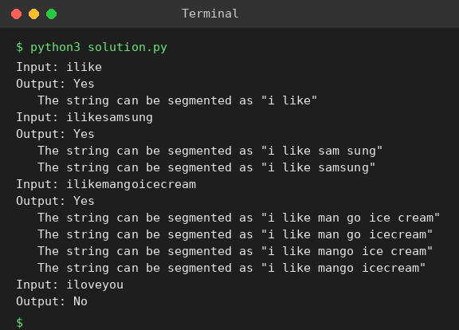

# Exp 55: Word Break: All Segmentations

## Aim
To check whether a string can be segmented using a dictionary and to print every segmentation.

## Algorithm
1. Recursively try every dictionary word that is a prefix of the remaining string
2. Memoise results for each start index
3. Join the chosen words with spaces to form each segmentation
4. Print Yes with the segmentations, otherwise No

## Input
```
Dictionary: {i, like, sam, sung, samsung, mobile, ice, cream, icecream, man, go, mango}
ilike
ilikesamsung
```

## Program
[`solution.py`](solution.py)

```python
from functools import lru_cache

D = {"i", "like", "sam", "sung", "samsung", "mobile", "ice", "cream", "icecream", "man", "go", "mango"}

def segmentations(s):
    @lru_cache(None)
    def go(i):
        if i == len(s):
            return [[]]
        res = []
        for j in range(i + 1, len(s) + 1):
            if s[i:j] in D:
                res += [[s[i:j]] + rest for rest in go(j)]
        return res
    return [" ".join(x) for x in go(0)]

for s in ("ilike", "ilikesamsung", "ilikemangoicecream", "iloveyou"):
    segs = segmentations(s)
    print(f"Input: {s}")
    print("Output:", "Yes" if segs else "No")
    for x in segs:
        print(f'   The string can be segmented as "{x}"')
```

## Output
```
Input: ilike
Output: Yes
   The string can be segmented as "i like"
Input: ilikesamsung
Output: Yes
   The string can be segmented as "i like sam sung"
   The string can be segmented as "i like samsung"
Input: ilikemangoicecream
Output: Yes
   The string can be segmented as "i like man go ice cream"
   The string can be segmented as "i like man go icecream"
   The string can be segmented as "i like mango ice cream"
   The string can be segmented as "i like mango icecream"
Input: iloveyou
Output: No
```

## Screenshot


## Result
The program for **Word Break: All Segmentations** was implemented and executed successfully, and the output shown above was obtained for all the given test cases.

## Time and Space Complexity
| | Complexity |
|---|---|
| **Time** | O(n^2) to decide, exponential in the number of segmentations |
| **Space** | O(n) |
